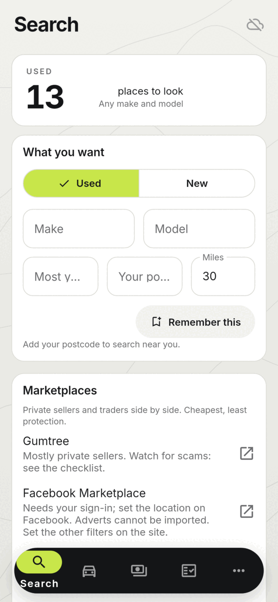
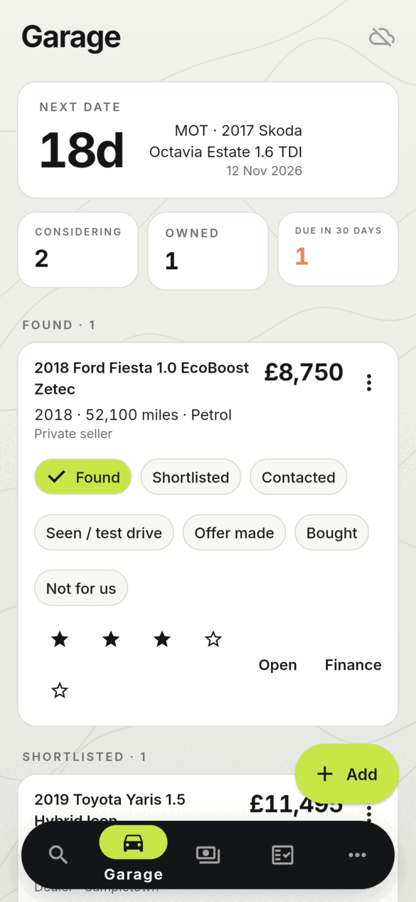
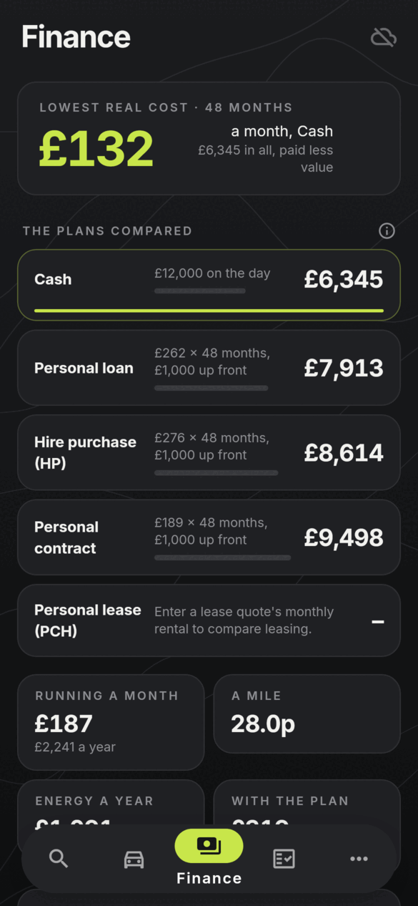
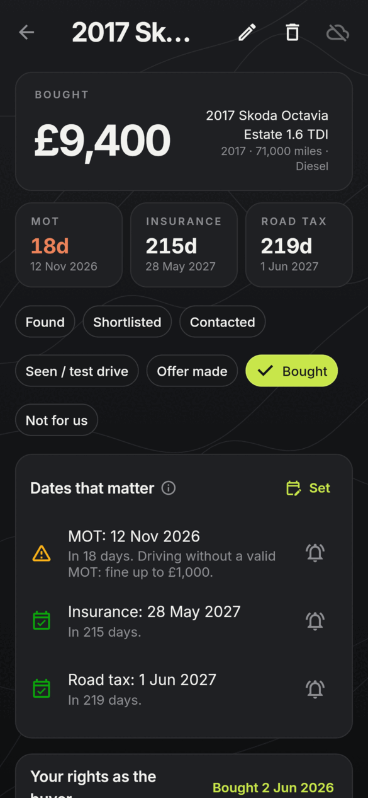
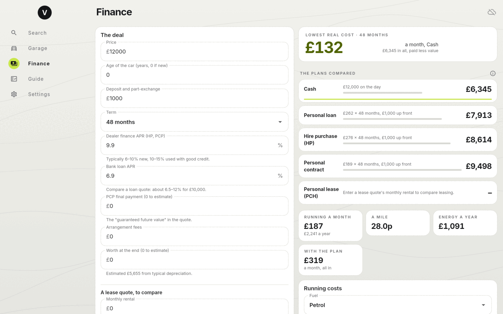
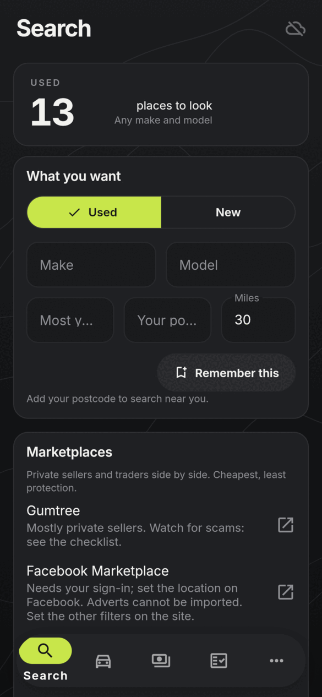
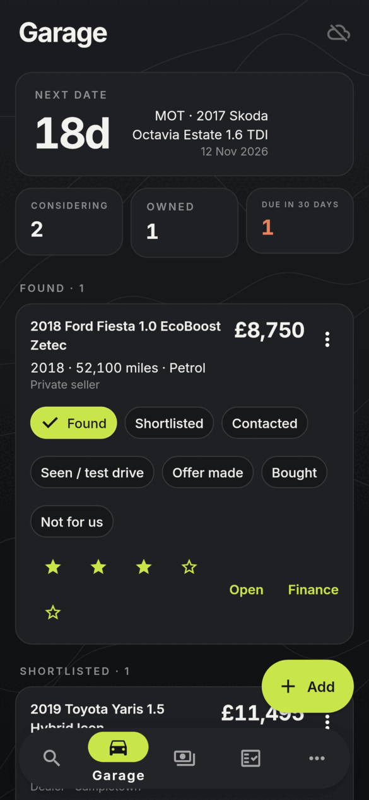
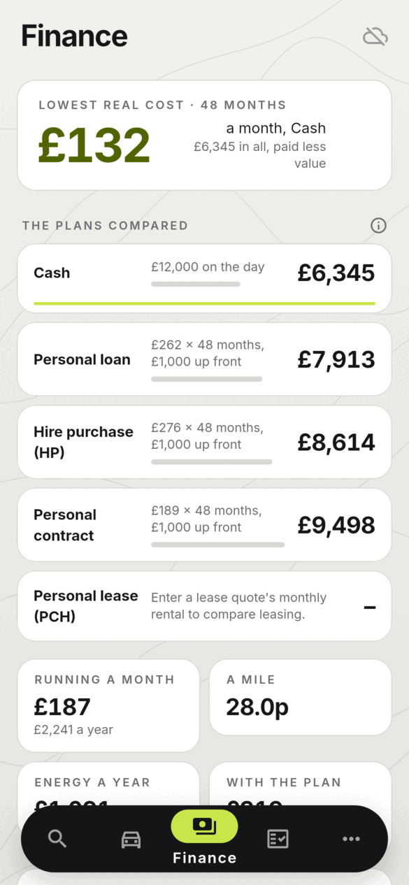
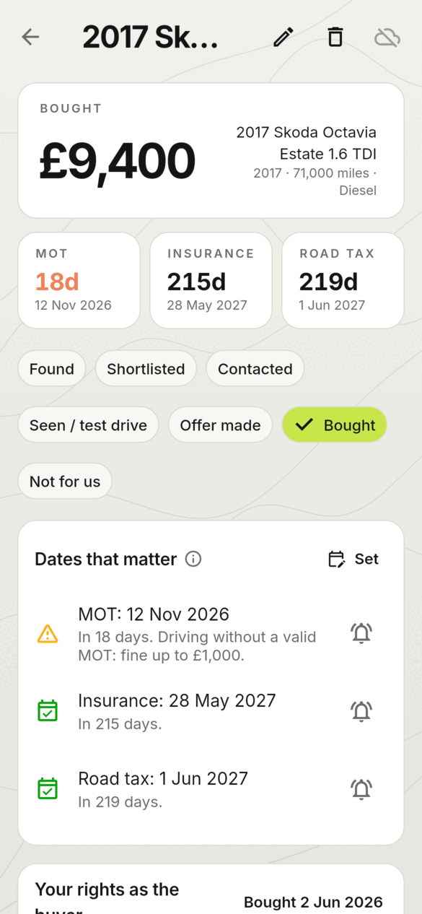
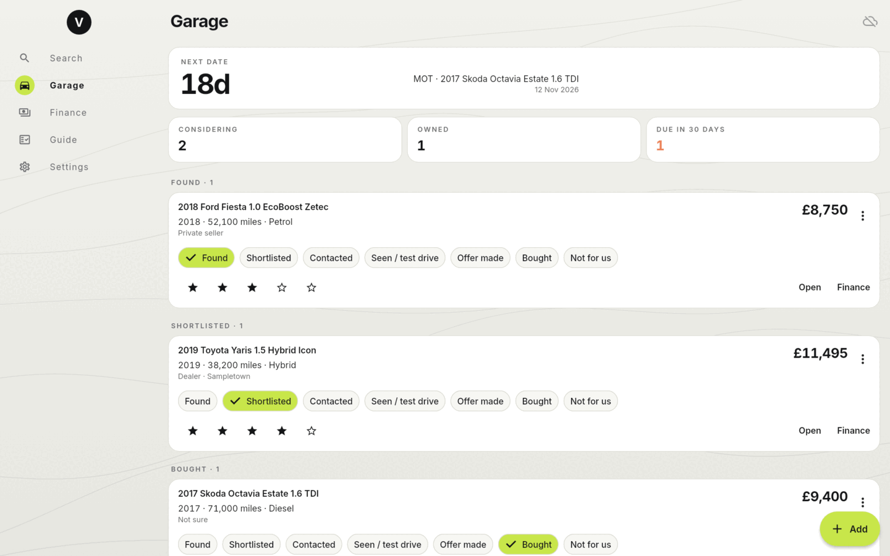

<h1 align="center">
  <br>
  <a href="https://github.com/sudharamachandranrajeev/vahana-anveshana"></a>
  <br>
  Vahana Anveshana
  <br>
</h1>

<h4 align="center">Buying, owning and selling cars: search, finance, running costs and paperwork, for Linux, Windows 11 and Android.</h4>

<p align="center">
  <a href="https://github.com/sudharamachandranrajeev/vahana-anveshana/releases"></a>
  
  
  
</p>

<p align="center">
  <a href="#key-features">Key Features</a> •
  <a href="#how-to-use">How To Use</a> •
  <a href="#download">Download</a> •
  <a href="#credits">Credits</a> •
  <a href="#related">Related</a> •
  <a href="#license">License</a>
</p>

<p align="center">
  
</p>

Vahana Anveshana is part of **Brahma**, a suite of life-management apps that share one encrypted
account. Its sibling for homes is
[Graha Anveshana](https://github.com/sudharamachandranrajeev/graha-anveshana). Status: early
releases, for testing. Local data lives in an encrypted SQLite database (SQLite3MultipleCiphers);
sync through your own PocketBase server is optional and end-to-end encrypted.

## Key Features

* **Search** – search links for AutoTrader, Gumtree, Facebook Marketplace, eBay, UsedCarsNI,
  DoneDeal, PistonHeads, online stores, dealer groups and new-car deal sites, filled in from your
  make, model, budget and postcode (Northern Ireland sites first for BT postcodes), plus your own
  sites. Pages open in your browser; only adverts you paste are read.
* **Garage** – cars you found, from an advert link or typed in, by stage. Each car's page has:
  * *Buying:* price against similar cars you saved, red flags (too cheap, odd mileage, used EV),
    asking-price history, free GOV.UK checks, and checklists for before paying and collection day.
  * *Owning:* MOT, tax, insurance and service dates counting down (first MOT 3 years on, 4 in
    Northern Ireland), calendar reminders, a logbook with real economy and cost a mile, PCP
    mileage pace, and dealer-rights dates.
  * *Selling:* offers side by side, a safe-selling list, the DVLA steps, a service history to
    paste into an advert, and the true cost of owning once sold.
* **Finance** – cash, loan, HP, PCP and lease compared by real cost, and running costs.
* **Guide** – rights, tax, the motor finance redress scheme and the checks before you pay.
* **Instrument-panel look** – charcoal canvas with faint contour lines, hairline cards, one lime
  accent, big tabular figures; light and dark; Inter bundled.
* **Private by default** – encrypted on the device; optional end-to-end encrypted sync on the
  shared Brahma account.

Figures are as of October 2026 and are a starting point for your own checks, not advice.

## Screenshots

<table>
  <tr>
    <td align="center"><br><sub>Search</sub></td>
    <td align="center"><br><sub>Garage</sub></td>
    <td align="center"><br><sub>Finance (dark)</sub></td>
    <td align="center"><br><sub>A car you own (dark)</sub></td>
  </tr>
</table>

<p align="center">
  <br><sub>Finance on the desktop</sub>
</p>

<details>
<summary>More screenshots</summary>

<table>
  <tr>
    <td align="center"><br><sub>Search (dark)</sub></td>
    <td align="center"><br><sub>Garage (dark)</sub></td>
    <td align="center"><br><sub>Finance</sub></td>
    <td align="center"><br><sub>A car you own</sub></td>
  </tr>
</table>

<br><sub>Garage on the desktop</sub>

</details>

All screenshots are rendered from the current code with made-up cars
(`test/screenshots_test.dart`).

## How To Use

To clone and run this application, you'll need [Git](https://git-scm.com) and
[Flutter](https://flutter.dev) 3.47 installed:

```bash
# Clone this repository
$ git clone https://github.com/sudharamachandranrajeev/vahana-anveshana

# Go into the repository
$ cd vahana-anveshana

# Install dependencies
$ flutter pub get

# Run the app
$ flutter run -d linux
```

`brahma_core` comes from the [brahma](https://github.com/sudharamachandranrajeev/brahma)
repository. To work on both at once, add a `pubspec_overrides.yaml` (ignored by git):

```yaml
dependency_overrides:
  brahma_core:
    path: ../brahma/core
```

```bash
# Test
$ flutter test

# Regenerate the database code
$ dart run build_runner build

# Render the screenshots (light, dark and desktop) into a folder
$ VAHANA_SHOTS=/tmp/shots flutter test test/screenshots_test.dart
```

## Download

Builds are on the [releases page](https://github.com/sudharamachandranrajeev/vahana-anveshana/releases),
each with `SHA256SUMS.txt`.

* **Linux (x86-64):** unpack `Vahana-<version>-linux-x64.tar.gz` and run `./install.sh` (for your
  user only; `./install.sh --uninstall` removes it). Needs GTK 3, libsecret and a running keyring.
* **Windows 10/11:** run the `-windows-x64-setup.exe` (no admin rights), or unzip the portable
  build. SmartScreen warns because the build is not code-signed: *More info > Run anyway*.
* **Android 7+:** install the `.apk`.

Cars saved in Anveshana 0.2.0 are not carried over automatically: add them again from their
advert links, or turn on sync.

## Credits

This software uses the following open source packages and services:

* [Flutter](https://flutter.dev) with [Riverpod](https://riverpod.dev)
* [drift](https://drift.simonbinder.eu) over SQLite3MultipleCiphers (via brahma_core)
* [http](https://pub.dev/packages/http), [intl](https://pub.dev/packages/intl),
  [url_launcher](https://pub.dev/packages/url_launcher)
* [Inter](https://rsms.me/inter/) typeface (SIL Open Font License)
* [PocketBase](https://pocketbase.io) for optional sync
* Free GOV.UK services: [MOT history](https://www.check-mot.service.gov.uk),
  [vehicle enquiry](https://vehicleenquiry.service.gov.uk),
  [recalls](https://www.check-vehicle-recalls.service.gov.uk)

## Related

* [Graha Anveshana](https://github.com/sudharamachandranrajeev/graha-anveshana) – the sibling app for homes
* [Artha](https://github.com/sudharamachandranrajeev/artha) – Brahma's personal-finance app
* [Udyoga](https://github.com/sudharamachandranrajeev/udyoga) – Brahma's career app
* [Vidya](https://github.com/sudharamachandranrajeev/vidya) – Brahma's learning app
* [brahma](https://github.com/sudharamachandranrajeev/brahma) – the shared core

## License

No licence has been chosen yet; all rights reserved. Inter is under the SIL Open Font License.

---

> GitHub [@sudharamachandranrajeev](https://github.com/sudharamachandranrajeev)
