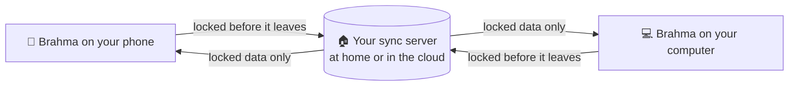

<h1 align="center">
  <br>
  <a href="https://github.com/sudharamachandranrajeev/brahma"></a>
  <br>
  Brahma
  <br>
</h1>

<h4 align="center">Your money, home, car, career, learning, shopping and social media in one private app, on your phone and computer.</h4>

<p align="center">
  <a href="https://github.com/sudharamachandranrajeev/brahma/releases"></a>
  
  
  
</p>

<p align="center">
  <a href="#-what-it-does">What it does</a> •
  <a href="#-the-brahma-family">The family</a> •
  <a href="#-get-started">Get started</a> •
  <a href="#-how-it-works">How it works</a> •
  <a href="#-faq-and-troubleshooting">FAQ</a> •
  <a href="#%EF%B8%8F-for-developers">For developers</a>
</p>

<p align="center">
  
</p>

Brahma is a family of personal apps, and **Brahma** is the one app that holds them all. Each app
keeps its own look and its own locked database, and one sign-in covers every app. Everything stays
on your devices unless you choose to sync through a server you own. Status: **early test
releases** (0.x). They work, but expect rough edges.

## ✨ What it does

- 🏠 **A life dashboard** – the home screen shows a card per app with its key numbers and the next
  thing to do. Tap a card to open the app; **All apps** brings you back.
- 🧩 **Seven apps in one** – money, career, property, cars, learning, shopping and social media,
  each in its own look. More Brahma apps appear as cards that open their download page.
- 🔒 **Locked on your device** – each app's data sits in an encrypted database. The key lives in
  your system's password store (keychain).
- 🔄 **Sync, only if you want it** – on first start, choose "this device only" or sync through
  your own server at home or on a free cloud plan. The server cannot read your data.
- 🔑 **One account for everything** – one password and one recovery key unlock every Brahma app on
  every device. Add a device by scanning a code.
- 🛡️ **Sentinel** – a security check-up on the home screen: updates, sync and device settings, and
  warnings about known flaws.
- 🔐 **App lock** (optional) – a PIN, your fingerprint or face, or Windows Hello before the app
  opens.
- 💬 **Help when you are stuck** – **Ask AI** explains any screen using an AI service you pick, and
  **Report a problem** fills in a GitHub issue for you to check and send.
- 🔔 **Update notice** – once a day, Brahma says when a newer version is out, with what's new and a
  **Download** button. ...and more.

## 🧩 The Brahma family

Seven apps run **inside** Brahma. Each one also ships on its own.

| App | What it does for you |
| --- | --- |
| [Artha](https://github.com/sudharamachandranrajeev/artha) | Money: accounts, spending, bills and investments |
| [Udyoga](https://github.com/sudharamachandranrajeev/udyoga) | Career: matched jobs, tailored CVs, applications and interview practice |
| [Graha Anveshana](https://github.com/sudharamachandranrajeev/graha-anveshana) | Property: finding a home to rent or buy, viewings and lettings |
| [Vahana Anveshana](https://github.com/sudharamachandranrajeev/vahana-anveshana) | Cars: buying, owning and selling, with MOT and tax dates |
| [Vidya](https://github.com/sudharamachandranrajeev/vidya) | Learning: courses, flashcards, skills and focus time |
| [Bhojana](https://github.com/sudharamachandranrajeev/bhojana) | Shopping: lists and UK grocery prices compared across shops |
| [Vani](https://github.com/sudharamachandranrajeev/vani) | Social media: scheduled posts, one inbox and alerts |

These run **on their own** for now. Their cards on the Brahma home screen open their download page.

| App | What it does for you |
| --- | --- |
| [Vastra](https://github.com/sudharamachandranrajeev/vastra) | Fashion and personal care: save products, find sellers, compare offers |
| [Arogya](https://github.com/sudharamachandranrajeev/arogya) | Health records |
| [Bhandara](https://github.com/sudharamachandranrajeev/bhandara) | Storage: disk health and space |
| [Ganana](https://github.com/sudharamachandranrajeev/ganana) | AI use: tokens, costs and limits |

## 📸 Screenshots

<table>
  <tr>
    <td align="center"><br><sub>Home</sub></td>
    <td align="center"><br><sub>Home (dark)</sub></td>
    <td align="center"><br><sub>Udyoga inside Brahma</sub></td>
  </tr>
  <tr>
    <td align="center"><br><sub>Vidya inside Brahma</sub></td>
    <td align="center"><br><sub>Vani inside Brahma</sub></td>
    <td align="center"><br><sub>Desktop (dark)</sub></td>
  </tr>
</table>

<sub>All screenshots show a made-up household, rendered from the current code.</sub>

## 🚀 Get started

### Step 1 – Download

Open the [releases page](https://github.com/sudharamachandranrajeev/brahma/releases) and, under
the newest release, pick the file for your device:

| Your device | File to download | Works on |
| --- | --- | --- |
| 🐧 Linux computer | `Brahma-<version>-linux-x64.tar.gz` | Ubuntu 24.04, Fedora, Arch and similar (Intel/AMD 64-bit) |
| 🪟 Windows computer | `Brahma-<version>-windows-x64-setup.exe` | Windows 10 and 11 |
| 🤖 Android phone | `Brahma-<version>-android.apk` | Android 7 and newer |

Each release also has `SHA256SUMS.txt`, a list of fingerprints to check the files are genuine.

### Step 2 – Install

<details>
<summary><b>🐧 Linux</b></summary>

1. Open a terminal in the folder where the download landed.
2. Unpack it and run the installer as your normal user (not `sudo`):
   ```sh
   tar -xzf Brahma-*-linux-x64.tar.gz
   cd brahma-*-linux-x64 && ./install.sh
   ```
3. Open **Brahma** from your app menu.

Brahma needs GTK 3, libsecret and a running keyring (GNOME Keyring or KWallet), which holds the
key to your data. To try it without installing, run `./brahma` in that folder. To remove it,
run `./install.sh --uninstall`. Your data stays.

</details>

<details>
<summary><b>🪟 Windows</b></summary>

1. Double-click `Brahma-<version>-windows-x64-setup.exe`. No admin rights needed.
2. Windows may say *"Windows protected your PC"*. This appears because the app isn't paid-signed
   yet, not because it is harmful. Click **More info → Run anyway**.
3. Follow the installer, then open **Brahma** from the Start menu.

Prefer no installer? Download `…-windows-x64-portable.zip`, unzip it anywhere and run `brahma.exe`.

</details>

<details>
<summary><b>🤖 Android</b></summary>

1. Open the downloaded `.apk` on your phone.
2. If Android asks, allow installs from your browser or file manager. This is normal for apps
   from outside the Play Store.
3. Tap **Install**, then **Open**.

Newer versions install over the top and keep your data.

</details>

### Step 3 – First launch

1. Brahma asks **where your data should live**. Pick **Keep everything on this device** to start.
   You can turn on sync later in **Settings → Sync**.
2. The home screen shows a card per app. Tap one, for example **Artha**, to set it up.
3. Tap **All apps** (the grid icon) to come back to the home screen.

### Step 4 (optional) – Use it on more than one device

1. Set up your own sync server: at home on any Linux computer that stays on, or free on
   Cloudflare. The [sync server guide](server/README.md) walks you through it, step by step.
2. In Brahma, open **Settings → Set up sync** and choose **Home server** or **Cloud server**. Paste the
   setup link the server printed, or tap **Find my home server** on the same Wi-Fi.
3. Choose **Create account**. **Write down the recovery key** it shows and keep it away from the
   device.
4. To add your next device, open **Settings → Add a device** here. On the new device, choose
   **Sync across my devices → Join from a device I already use**, then scan or paste the code.

The same account works in every Brahma app, inside Brahma or on its own.

## 🧭 How it works



- **Each app keeps its own database** inside Brahma, encrypted with a key from your keychain.
- **Sync is optional.** Without it, nothing leaves the device.
- **With sync**, each device encrypts its changes before sending them. The server stores and
  passes them on, but cannot read them (end-to-end encryption: only your devices hold the key).
- **What Brahma itself contacts**: your sync server, if you use one, and GitHub to look for new
  versions (switch that off under **Sentinel**). Each app lists its own online services in its
  **Settings**.

> [!IMPORTANT]
> Your password and recovery key are the only ways to unlock synced data. If you lose both, nobody
> can recover it, not even the server owner. On Android, uninstalling the app deletes its data, so
> sync first.

## ❓ FAQ and troubleshooting

<details>
<summary><b>Do I need an account or the internet?</b></summary>

No. Brahma works offline on one device. You only need a server if you want sync.
</details>

<details>
<summary><b>I already use Artha (or another app) on its own. Will Brahma see that data?</b></summary>

Not by itself. Brahma keeps its own copy, so both can run side by side. To share data between
them, sign both into the same sync account.
</details>

<details>
<summary><b>Windows says the app might be unsafe</b></summary>

The build isn't code-signed (a paid certificate). Click **More info → Run anyway**. Check the file
against `SHA256SUMS.txt` on the release if you want to be sure it is genuine.
</details>

<details>
<summary><b>Linux: Brahma will not start and talks about a key</b></summary>

The key that unlocks your data lives in the desktop keyring. Make sure GNOME Keyring or KWallet is
running and unlocked, then start Brahma again.
</details>

<details>
<summary><b>Where is my data stored?</b></summary>

Linux: `~/.local/share/dev.brahma.app`. Windows: under `%APPDATA%\Brahma`. Android: inside the
app. Uninstalling on Linux or Windows leaves it in place.
</details>

<details>
<summary><b>Does Ask AI see my data?</b></summary>

No. It sends only the name of the screen and your question. The simplest choice opens ChatGPT,
Claude or Gemini in your browser with the question filled in. You can also use your own key or an
AI on your own computer.
</details>

## 🛠️ For developers

<details>
<summary>Build from source, test and release</summary>

You need [Git](https://git-scm.com) and [Flutter](https://flutter.dev) 3.47. On Linux also
`clang cmake ninja-build pkg-config libgtk-3-dev libsecret-1-dev`.

```bash
git clone https://github.com/sudharamachandranrajeev/brahma
cd brahma/app
flutter pub get
flutter run -d linux        # or windows, or an Android device

flutter analyze && flutter test                                    # check and test
BRAHMA_SHOTS=/tmp/shots FLUTTER_ROOT=<flutter sdk> \
  flutter test test/screenshots_test.dart                          # render the screenshots
```

What lives where:

- `app/`: Brahma, the all-in-one app.
- `apps/<name>/`: each app, as a git subtree of its own repository. Never edit them here: change
  the app's repository, then run `scripts/pull-apps.sh` (or `scripts/pull-apps.sh <name>`).
- `core/`: `brahma_core`, the shared package: encrypted database, sync, pairing, app frame,
  Sentinel and `SuiteApp` ([core/README.md](core/README.md)).
- `server/`: the sync server, home or Cloudflare ([server/README.md](server/README.md)).
- `sentinel/`: signed security advisories every app shows ([sentinel/README.md](sentinel/README.md)).
- `watch/`: Brahma Watch, a Cloudflare Worker that checks saved property searches and pushes
  alerts through ntfy ([watch/README.md](watch/README.md)).

To add an app: export a `SuiteApp` from its `lib/suite.dart`, add it with
`git subtree add --prefix apps/<name> <repo url> main`, then add the path dependency to
`app/pubspec.yaml` and the app to `app/lib/app/apps.dart`. Core needs no change.

A `v*` tag builds, smoke-tests and publishes the Android, Windows and Linux builds
(`.github/workflows/release.yml`). Changes per version: [CHANGELOG.md](CHANGELOG.md).

</details>

<details>
<summary>Credits</summary>

- [Flutter](https://flutter.dev) and [Riverpod](https://riverpod.dev)
- [drift](https://drift.simonbinder.eu) and [sqlite3](https://pub.dev/packages/sqlite3) with
  [SQLite3MultipleCiphers](https://utelle.github.io/SQLite3MultipleCiphers/)
- [cryptography](https://pub.dev/packages/cryptography),
  [flutter_secure_storage](https://pub.dev/packages/flutter_secure_storage) and
  [qr](https://pub.dev/packages/qr)
- [PocketBase](https://pocketbase.io) for the original sync server
- [Cloudflare Workers](https://workers.cloudflare.com) and [ntfy](https://ntfy.sh) for the cloud
  sync server and Brahma Watch
- Known exploited flaws from [CISA's KEV catalogue](https://www.cisa.gov/known-exploited-vulnerabilities-catalog) for Sentinel

</details>

## Related

- [Vinyasa](https://github.com/sudharamachandranrajeev/vinyasa) – plan and rearrange a room, built
  on the same core (not in Brahma yet).
- [Adisthanam](https://github.com/sudharamachandranrajeev/adisthanam) – installs your own Brahma
  login and data server with one command.

## License

No licence has been chosen yet; all rights reserved.

---

> GitHub [@sudharamachandranrajeev](https://github.com/sudharamachandranrajeev)
