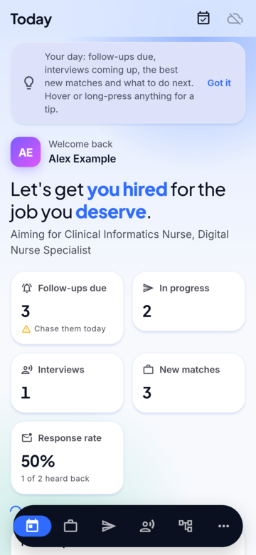
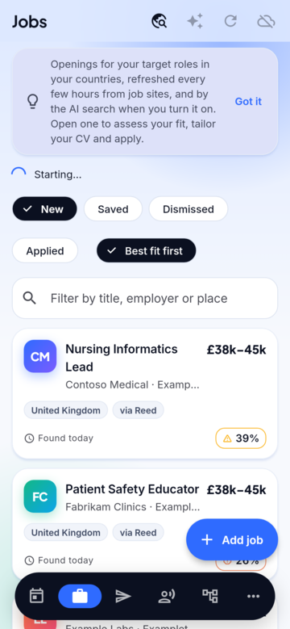
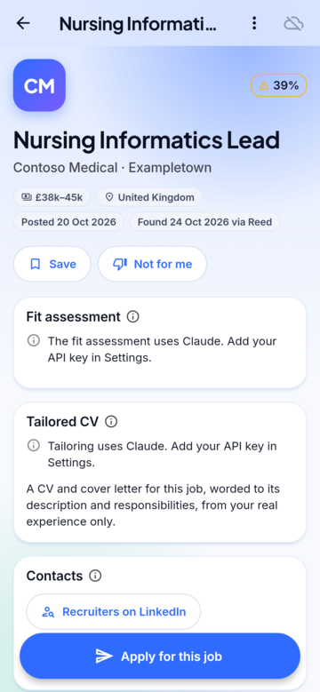
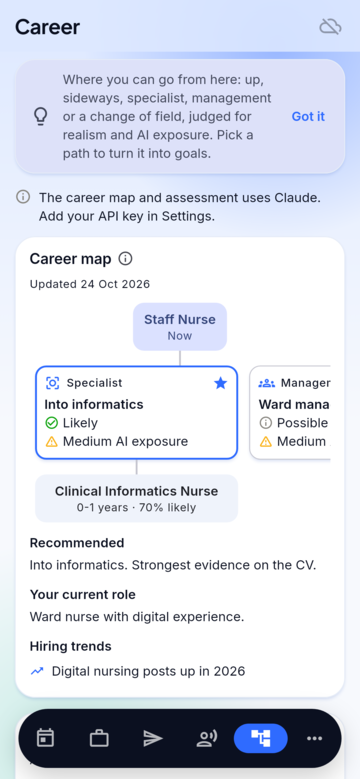

# Udyoga

A career and job-search manager for Linux, Windows 11 and Android: finds openings for you, judges
your fit honestly, tailors your CV to each advert, tracks every application and contact until you
hear back, maps where your career can go next and trains you for the interview. Part of
**Brahma**, a suite of life-management apps that share one encrypted account (with
[Artha](https://github.com/sudharamachandranrajeev/artha) for money and
[Anveshana](https://github.com/sudharamachandranrajeev/anveshana) for property). The shared core
lives in [brahma](https://github.com/sudharamachandranrajeev/brahma).

Status: first release, for testing. Built with Flutter 3.47.7; local data in an encrypted SQLite
database (SQLite3MultipleCiphers); optional sync through your own PocketBase server with end-to-end
encryption.

<p>
  
  
  
  
</p>

## What it does

- **Profile.** Import your CV (PDF, Word or text) and Claude reads it into experience, education,
  skills and achievements. Set the roles, countries, places and ways of working you are aiming for.
- **Jobs.** Openings for your target roles in every country you choose, from free job APIs (Adzuna,
  Reed, Remotive, Jobicy, Arbeitnow), refreshed every few hours while the app is open, plus an
  optional AI web search of employer and public-sector sites. Duplicates across sites are merged.
  Each job gets a quick fit score; open one for a full **fit assessment**: verdict, matched
  requirements, gaps with how serious each is, and what to say about them.
- **Tailored CV.** A CV and cover letter for one advert, reworded to its description and
  responsibilities from your real experience only, with an applicant-tracking keyword score, the
  keywords you lack and what changed. Export to Word or plain text.
- **Applications.** Every application by stage (preparing, applied, screening, interview, offer,
  closed). Moving on sets the next follow-up; six weeks of silence marks it *No reply*. Claude
  drafts the chaser, the thank-you note and, after a rejection, a request for feedback. Follow-ups
  go to your own calendar (Google Calendar link, or an `.ics` file for all of them) so they ring on
  every device.
- **Contacts.** Recruiters, hiring managers and people in the field, found by Claude from public
  pages or added by you, each with a follow-up date and a drafted first message. LinkedIn is opened
  through its own search links; the app never scrapes it.
- **Interview training.** Practice rounds for a job or a role: mixed, competency (STAR), technical,
  *toughest panel* and *AI and change*. Type each answer; the app measures length, speaking time,
  filler words, "I" against "we", figures and STAR coverage as you go, and Claude scores it on seven
  dimensions (including readiness for AI in your field), names red flags, writes a stronger version
  in your own voice and asks the follow-up a tough panel would.
- **Career.** A blunt assessment of where you stand (market position, strengths, weaknesses, the
  toughest challenges, how AI is changing your work, target roles and countries with right-to-work
  notes) and a **career map**: five to eight paths from your current role, up, sideways,
  specialist, management or a change of field, each with steps, timeframes, pay, likelihood and AI
  exposure. Redone monthly when the AI routine is on.
- **Growth.** Certifications, courses and experience to get, from the assessment and the paths you
  pick, with priority, cost, target date and progress.

The AI features use your own [Claude API key](https://console.anthropic.com/) (Settings), which is
kept in the encrypted, synced settings. Job-site keys for Adzuna and Reed are free and optional.

## Look and feel

A light azure canvas (deep navy at night) with white cards that lift and tilt toward the pointer,
a floating pill navigation bar, pages that rise in with depth, and a company logo that flies from
the list into the job's page. Motion follows the system's reduced-motion setting. Text is set in
[Inter](https://rsms.me/inter/) for clarity at small sizes, with headings in
[Plus Jakarta Sans](https://github.com/tokotype/PlusJakartaSans); both are bundled under the SIL
Open Font License (`assets/fonts`), so nothing is fetched at run time.

## Install a test build

Builds are on the [releases page](https://github.com/sudharamachandranrajeev/udyoga/releases),
each with `SHA256SUMS.txt`.

- **Linux (x86-64):** unpack `Udyoga-<version>-linux-x64.tar.gz` and run `./install.sh` (for your
  user only; `./install.sh --uninstall` removes it). Needs GTK 3, libsecret and a running keyring,
  which holds the database key.
- **Windows 10/11:** run `Udyoga-<version>-windows-x64-setup.exe` (no admin rights), or unzip the
  portable build. SmartScreen warns because the build is not code-signed: *More info > Run anyway*.
- **Android 7+:** install `Udyoga-<version>-android.apk`.

Your data stays on the device, encrypted, until you turn on sync. An account made in any Brahma
app works in all of them.

## Develop

```sh
flutter pub get
flutter run -d linux
```

`brahma_core` comes from the brahma repository. To work on both at once, add a
`pubspec_overrides.yaml` (ignored by git):

```yaml
dependency_overrides:
  brahma_core:
    path: ../brahma/core
```

## Test

```sh
flutter analyze && flutter test
```

Tests use made-up people and companies only. `UDYOGA_SHOTS=<folder> flutter test
test/screenshots_test.dart` renders the main pages with the real fonts to PNG files.

CI runs analyze and the tests on each push; a `v*` tag builds, smoke-tests and publishes the
Android, Windows and Linux builds (`.github/workflows/release.yml`). `scripts/make-icons.sh`
regenerates the icons from `branding/udyoga.svg`.
