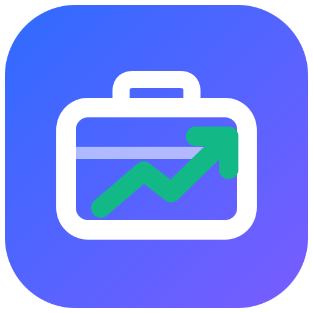
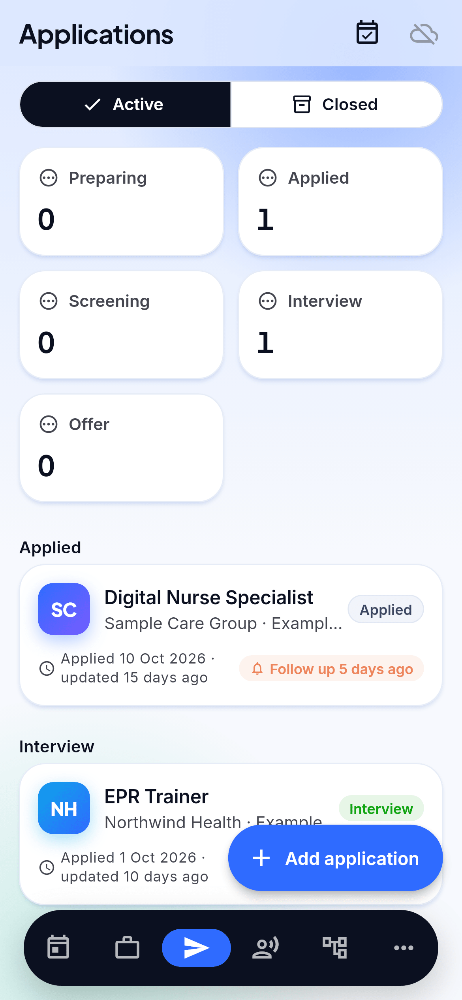
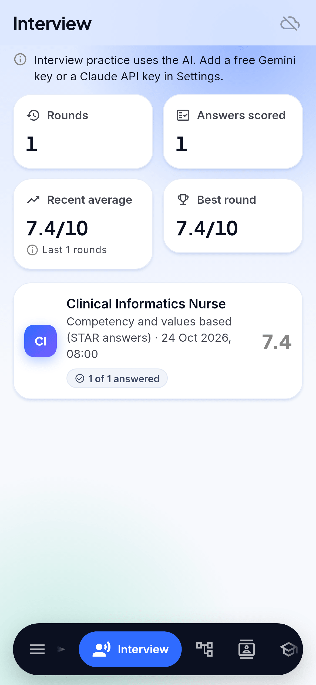
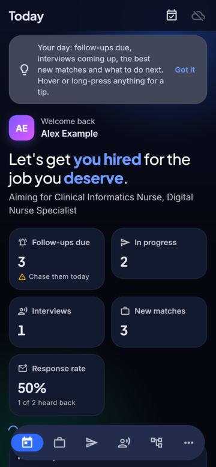
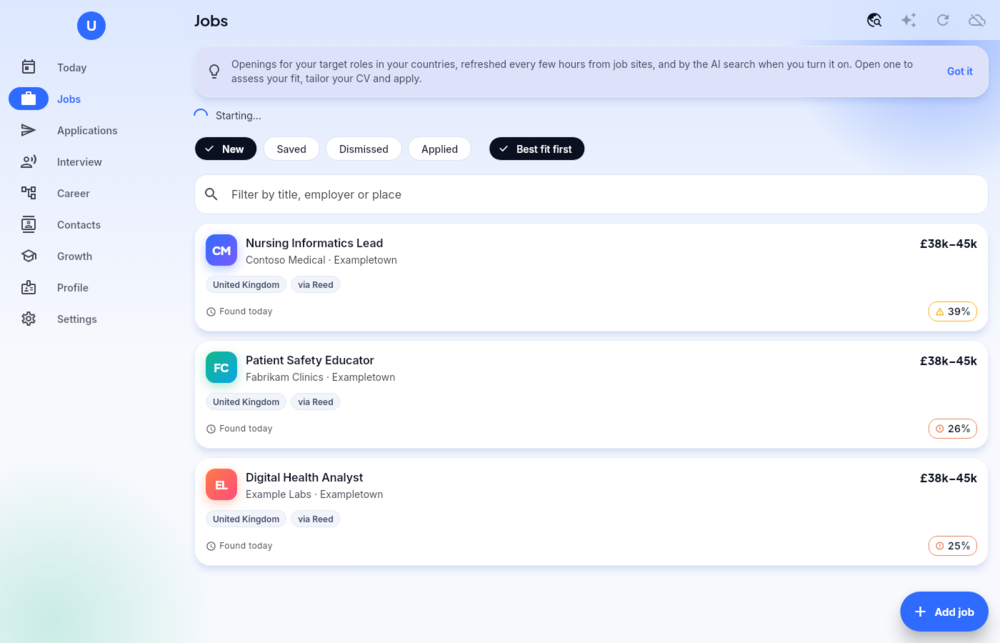

<h1 align="center">
  <br>
  <a href="https://github.com/sudharamachandranrajeev/udyoga"></a>
  <br>
  Udyoga
  <br>
</h1>

<h4 align="center">A career and job-search manager for Linux, Windows and Android: find openings, judge your fit honestly, tailor your CV, track every application and train for the interview.</h4>

<p align="center">
  <a href="https://github.com/sudharamachandranrajeev/udyoga/releases"></a>
  
  
  
</p>

<p align="center">
  <a href="#key-features">Key Features</a> •
  <a href="#how-to-use">How To Use</a> •
  <a href="#download">Download</a> •
  <a href="#credits">Credits</a> •
  <a href="#related">Related</a> •
  <a href="#license">License</a>
</p>

<p align="center">
  
</p>

## Key Features

* **Profile from your CV** – import a PDF, Word or text CV and the AI reads it into experience,
  education, skills and achievements; set the roles, countries, places and ways of working you want.
  Import several tailored versions at once and they become one master profile: each job once, every
  skill, the roles each version aims at added to your targets, and certifications you hold on Growth.
* **Jobs, found for you** – openings for your target roles in every country you choose, from free job
  APIs (Adzuna, Reed, Remotive, Jobicy, Arbeitnow), refreshed every few hours while the app is open,
  plus an optional AI web search of employer and public-sector sites. Duplicates are merged.
* **Honest fit assessment** – a quick fit score on every job; open one for the verdict, matched
  requirements, gaps with how serious each is, and what to say about them.
* **Tailored CV and cover letter** – reworded to one advert from your real experience only, with an
  applicant-tracking keyword score, missing keywords and what changed. Export to Word or text.
* **Applications by stage** – preparing, applied, screening, interview, offer, closed. Moving on sets
  the next follow-up; six weeks of silence marks it *No reply*. AI drafts the chaser, the thank-you
  note and, after a rejection, a feedback request. Follow-ups go to Google Calendar or an `.ics` file.
* **Contacts** – recruiters, hiring managers and people in the field, found from public pages or
  added by you, each with a follow-up date and a drafted first message. LinkedIn is opened through
  its own search links; the app never scrapes it.
* **n8n lead workflow (optional)** – connect your own [n8n](https://n8n.io) and a job can ask it for
  contacts from public search results, ranked by the AI with a short connection note. You send every
  request yourself. Workflow, set-up and a study of what LinkedIn allows: [docs/n8n](docs/n8n/README.md).
* **Interview training** – mixed, competency (STAR), technical, *toughest panel* and *AI and change*
  rounds. Live measures of length, speaking time, filler words, "I" against "we", figures and STAR
  coverage; the AI scores seven dimensions, names red flags, writes a stronger answer in your voice
  and asks the follow-up a tough panel would.
* **Career map** – a blunt assessment of where you stand (market position, strengths, weaknesses, how
  AI is changing your work, target roles and countries with right-to-work notes) and five to eight
  paths from your current role, each with steps, timeframes, pay, likelihood and AI exposure. Redone
  monthly when the AI routine is on.
* **Growth** – certifications, courses and experience to get, with priority, cost, target date and progress.
  *Ideas and wins* keeps anything that could move your career on (a tip, a company to watch, praise at
  work) in a few seconds; the AI reads them in every request, and an idea can become a goal.
* **LinkedIn data import** – ask LinkedIn for a copy of your data and import the ZIP on the Growth page:
  jobs, skills and certifications fill gaps in your profile, recommendations become wins, recent
  applications and saved jobs join your pipeline, and connections at employers you pursue (and
  recruiters) become contacts. Read on the device; Udyoga never signs in to LinkedIn. Importing again
  doubles nothing.
* **LinkedIn studio** – eleven tools, all drafting for you to post or send by hand: a 100-point profile
  score with rewrites, posts (18 hook formulas), comments, connection notes with follow-ups (also from
  a contact), inbox triage, replies to comments on your posts, a week plan, a post audit, carousels
  (saved as a PDF to upload) and repurposing a long piece. Every draft is written in your own voice
  and cleaned on the device of dashes, invisible characters and stock phrases, with a five-check
  score. The same check runs on a CV or cover letter. Nothing is posted or automated for you.
* **Your Claude or ChatGPT subscription** – on Linux and Windows, Settings > AI can use the Claude
  Code or Codex you already have, signed in to your own Claude or ChatGPT plan, instead of an API key,
  for every AI feature. Udyoga never handles your login. Its permission lasts 24 hours; at the next
  start it asks you to renew.
* **In-app updates** – at start (switch it off in Settings > Updates) and on demand, Udyoga finds a
  newer GitHub release, asks, checks the download against `SHA256SUMS.txt` and installs it (release
  builds only).
* **Private by design** – encrypted local database, optional end-to-end encrypted sync through your
  own PocketBase server, one account across every Brahma app.
* **Light and dark** – an azure canvas (deep navy at night), cards that tilt toward the pointer, a
  floating pill navigation bar and depth page transitions; motion follows the reduced-motion setting.

<details>
<summary><b>AI keys and privacy</b></summary>

The AI features use your own key (Settings), kept in the encrypted, synced settings: a free
[Gemini key](https://aistudio.google.com/apikey) (sign in with a Google account and press Create API
key; Gemini 3.8 Flash or 3.5 Flash-Lite on the free tier) or a
[Claude API key](https://console.anthropic.com/). With keys for both, choose the model in Settings.
On Google's free tier, prompts may be used to improve Google's products except in the UK, EEA and
Switzerland. Job-site keys for Adzuna and Reed are free and optional.

On Linux and Windows you can use your Claude subscription instead: install
[Claude Code](https://code.claude.com/docs/en/setup), then Settings > AI > Connect. Udyoga runs your
own Claude Code, which keeps your sign-in to itself; Udyoga stores only the time you allowed it.
A ChatGPT plan works the same way through [Codex](https://developers.openai.com/codex/cli) (sign in
with `codex login`), using Codex's default model. Codex cannot read PDFs here, so paste your CV's
text when reading a CV with it.

Your data stays on the device, encrypted, until you turn on sync. An account made in any Brahma app
works in all of them.
</details>

## Screenshots

<table>
  <tr>
    <td align="center"><br><sub>Today</sub></td>
    <td align="center"><br><sub>Jobs</sub></td>
    <td align="center"><br><sub>A job</sub></td>
    <td align="center"><br><sub>Applications</sub></td>
  </tr>
  <tr>
    <td align="center"><br><sub>Interview practice</sub></td>
    <td align="center"><br><sub>Career map</sub></td>
    <td align="center"><br><sub>Today (dark)</sub></td>
    <td align="center"><br><sub>Jobs on desktop</sub></td>
  </tr>
</table>

## How To Use

To clone and run this application, you'll need [Git](https://git-scm.com) and
[Flutter](https://flutter.dev) 3.47 installed:

```bash
# Clone this repository
$ git clone https://github.com/sudharamachandranrajeev/udyoga

# Go into the repository
$ cd udyoga

# Install dependencies
$ flutter pub get

# Run the app
$ flutter run -d linux

# Analyze and test
$ flutter analyze && flutter test

# Render the main pages to PNG with the real fonts
$ UDYOGA_SHOTS=/tmp/shots flutter test test/screenshots_test.dart
```

`brahma_core` comes from the [brahma](https://github.com/sudharamachandranrajeev/brahma) repository.
To work on both at once, add a `pubspec_overrides.yaml` (ignored by git):

```yaml
dependency_overrides:
  brahma_core:
    path: ../brahma/core
```

Tests use made-up people and companies only. CI runs analyze and the tests on each push; a `v*` tag
builds, smoke-tests and publishes the Android, Windows and Linux builds
(`.github/workflows/release.yml`). `scripts/make-icons.sh` regenerates the icons from
`branding/udyoga.svg`.

## Download

Test builds are on the [releases page](https://github.com/sudharamachandranrajeev/udyoga/releases),
each with `SHA256SUMS.txt`. See the [changelog](CHANGELOG.md) for what is new.

* **Linux (x86-64)** – unpack `Udyoga-<version>-linux-x64.tar.gz` and run `./install.sh` (for your user
  only; `./install.sh --uninstall` removes it). Needs GTK 3, libsecret and a running keyring, which
  holds the database key.
* **Windows 10/11** – run `Udyoga-<version>-windows-x64-setup.exe` (no admin rights), or unzip the
  portable build. SmartScreen warns because the build is not code-signed: *More info > Run anyway*.
* **Android 7+** – install `Udyoga-<version>-android.apk`.

## Credits

This software uses the following open source packages and services:

- [Flutter](https://flutter.dev) and [Riverpod](https://riverpod.dev)
- [drift](https://drift.simonbinder.eu) over [SQLite3MultipleCiphers](https://utelle.github.io/SQLite3MultipleCiphers/) for the encrypted database
- [PocketBase](https://pocketbase.io) for optional self-hosted sync
- [http](https://pub.dev/packages/http), [file_picker](https://pub.dev/packages/file_picker), [archive](https://pub.dev/packages/archive), [url_launcher](https://pub.dev/packages/url_launcher), [intl](https://pub.dev/packages/intl)
- Job data from [Adzuna](https://www.adzuna.com), [Reed](https://www.reed.co.uk), [Remotive](https://remotive.com), [Jobicy](https://jobicy.com) and [Arbeitnow](https://www.arbeitnow.com)
- AI by [Gemini](https://ai.google.dev) or [Claude](https://www.anthropic.com/claude), with your own key
- Fonts [Inter](https://rsms.me/inter/) and [Plus Jakarta Sans](https://github.com/tokotype/PlusJakartaSans), bundled under the SIL Open Font License

## Related

Udyoga is part of **Brahma**, a suite of life-management apps that share one encrypted account:

* [brahma](https://github.com/sudharamachandranrajeev/brahma) – the shared core and the all-in-one Brahma app
* [Artha](https://github.com/sudharamachandranrajeev/artha) – personal finance
* [Graha Anveshana](https://github.com/sudharamachandranrajeev/graha-anveshana) – property search
* [Vahana Anveshana](https://github.com/sudharamachandranrajeev/vahana-anveshana) – car search
* [Vidya](https://github.com/sudharamachandranrajeev/vidya) – learning, skills and portfolio

## License

No licence has been chosen yet; all rights reserved.

---

> GitHub [@sudharamachandranrajeev](https://github.com/sudharamachandranrajeev)
