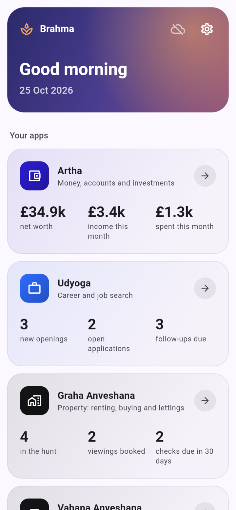
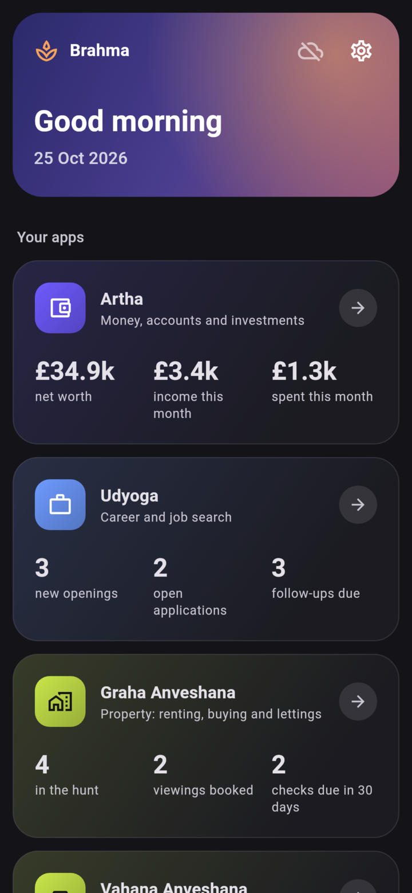
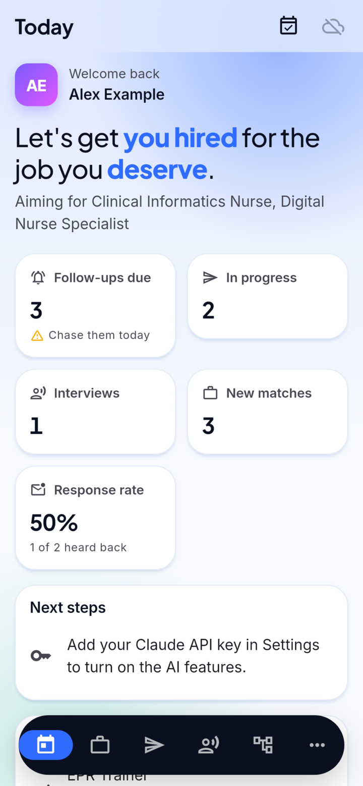
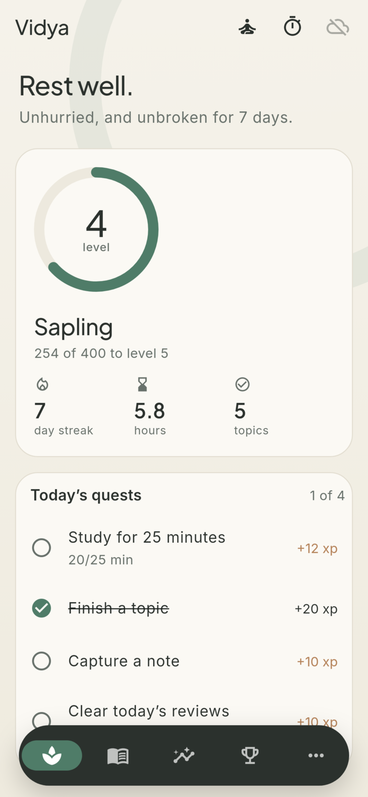
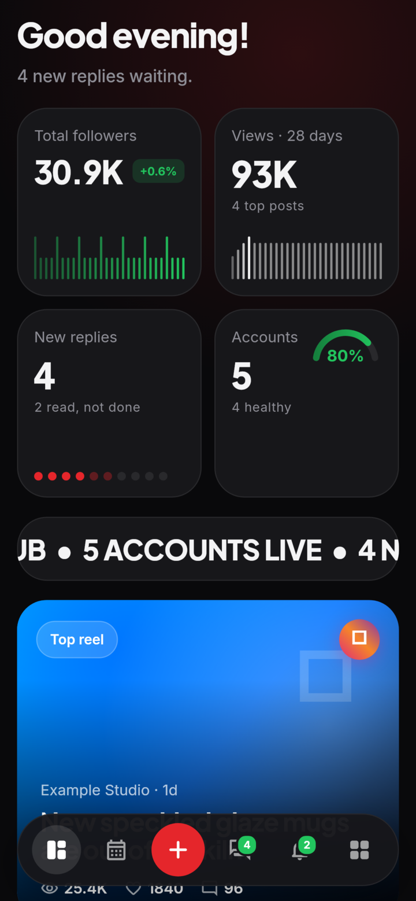
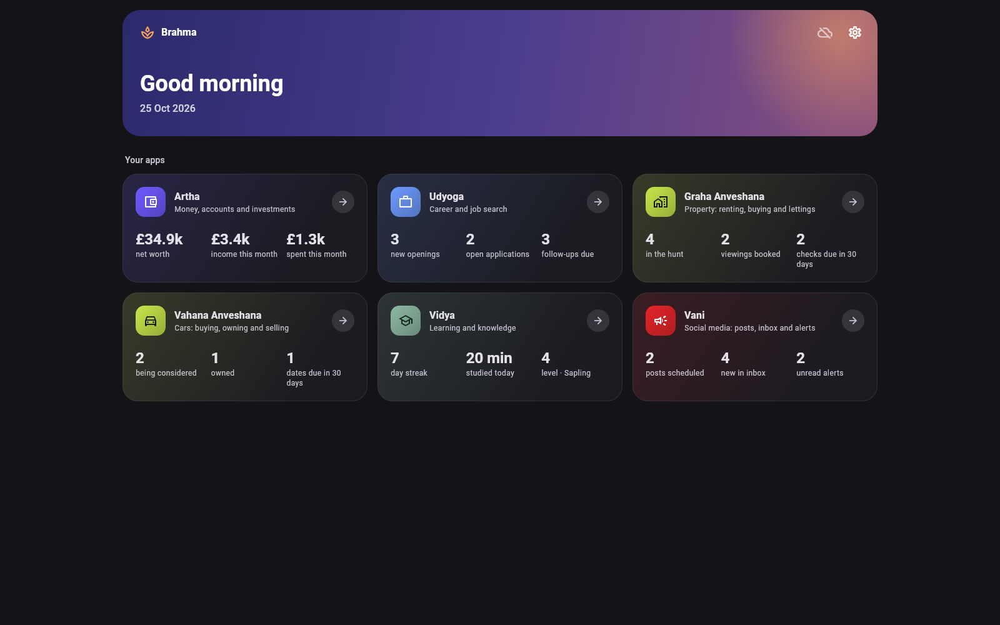

<h1 align="center">
  <br>
  <a href="https://github.com/sudharamachandranrajeev/brahma"></a>
  <br>
  Brahma
  <br>
</h1>

<h4 align="center">A private life-management suite: money, property, cars, career, social media and learning in one app, with one end-to-end encrypted sync account. Linux, Windows and Android.</h4>

<p align="center">
  <a href="https://github.com/sudharamachandranrajeev/brahma/releases"></a>
  
  
  
</p>

<p align="center">
  <a href="#key-features">Key Features</a> •
  <a href="#how-to-use">How To Use</a> •
  <a href="#download">Download</a> •
  <a href="#credits">Credits</a> •
  <a href="#related">Related</a> •
  <a href="#license">License</a>
</p>

<p align="center">
  
</p>

Brahma is a suite of separate apps that share one core and one sync account, plus **Brahma**, the
one app that holds them all. Each app is developed and shipped in its own repository and pulled in
here as a git subtree.

## Key Features

* **Life dashboard** – the home screen shows a live card per app with its key figures and the next
  thing to do; a card opens the app and "All apps" comes back.
* **Every app, in its own look** – Artha (money), Graha Anveshana (property), Vahana Anveshana
  (cars), Udyoga (career), Vidya (learning) and Vani (social media) each keep their own theme and
  navigation inside Brahma.
* **One sign-in, one key, one sync account** – a single keychain entry unlocks every app; each app
  keeps its own encrypted database.
* **Encrypted at rest** – local databases use drift over SQLite3MultipleCiphers, with the key in the
  system keychain.
* **End-to-end encrypted sync** through your own PocketBase server: the server only sees
  ciphertext (Argon2id, HKDF, XChaCha20-Poly1305); rows carry hybrid-logical-clock stamps.
* **Pairing** – add a device from a QR code or link.
* **Standalone apps keep working** – the suite keeps its databases in its own data folder, so the
  separate apps run side by side with it.
* **Brahma Watch** (`watch/`) – a Cloudflare Worker that checks saved property searches every 10
  minutes and pushes changes to your phone through ntfy; it is also Vani's social hub.
* **Open to new apps** – an app joins with a `SuiteApp` in its `lib/suite.dart`; core needs no
  change.

## Screenshots

<table>
  <tr>
    <td align="center"><br><sub>Home</sub></td>
    <td align="center"><br><sub>Home (dark)</sub></td>
    <td align="center"><br><sub>Udyoga inside Brahma</sub></td>
  </tr>
  <tr>
    <td align="center"><br><sub>Vidya inside Brahma</sub></td>
    <td align="center"><br><sub>Vani inside Brahma</sub></td>
    <td align="center"><br><sub>Desktop (dark)</sub></td>
  </tr>
</table>

All data in the screenshots is made up (see `app/test/seed.dart`).

## How To Use

To clone and run the suite app, you'll need [Git](https://git-scm.com) and
[Flutter](https://flutter.dev) 3.47 installed (on Linux also `clang cmake ninja-build pkg-config
libgtk-3-dev libsecret-1-dev`):

```bash
# Clone this repository
$ git clone https://github.com/sudharamachandranrajeev/brahma

# Go into the suite app
$ cd brahma/app

# Install dependencies
$ flutter pub get

# Run the tests, then the app
$ flutter test
$ flutter run -d linux

# Build a release (or windows, apk)
$ flutter build linux --release
```

Screenshots: `BRAHMA_SHOTS=/tmp/shots FLUTTER_ROOT=<flutter sdk> flutter test test/screenshots_test.dart`
fills every app with made-up data and renders the home screen and a few hosted apps, phone and
desktop, light and dark, to PNG files.

<details>
<summary><b>Repository layout</b></summary>

- `app/`: **Brahma**, the suite app. Its home screen is a life dashboard with a live card per app;
  a card opens the app, in its own look, and "All apps" comes back. One sign-in and one sync
  account cover every app; each app keeps its own encrypted database.
- `apps/<name>/`: each app, as a git subtree of its own repository (with full history). The apps
  are developed in their own repositories and keep shipping on their own; Brahma pulls their
  updates in.
- `core/`: `brahma_core`, the Flutter package with the encrypted database, sync, pairing, the app
  frame and `SuiteApp`, the way an app describes itself to the suite (see [core/README.md](core/README.md)).
- `watch/`: Brahma Watch, the cloud watcher that pushes alerts to your phone and hosts Vani's
  social hub (see [watch/README.md](watch/README.md) and [watch/SOCIAL.md](watch/SOCIAL.md)).

</details>

<details>
<summary><b>Updating the apps</b></summary>

Never edit `apps/<name>` here. Change the app's own repository and push, then:

```sh
scripts/pull-apps.sh            # every app
scripts/pull-apps.sh udyoga     # one app
```

</details>

<details>
<summary><b>Adding an app</b></summary>

1. In the app's repository, add `lib/suite.dart` exporting a `SuiteApp` (see any current app) and
   push.
2. Here: `git subtree add --prefix apps/<name> https://github.com/sudharamachandranrajeev/<name>.git main`
3. Add the path dependency to `app/pubspec.yaml` and the app to `app/lib/app/apps.dart`.

Core needs no change for a new app.

</details>

## Download

Builds are on the [releases page](https://github.com/sudharamachandranrajeev/brahma/releases)
(0.x versions are pre-releases). Each release has `SHA256SUMS.txt` for checking the downloads.

* **Linux** – `Brahma-<version>-linux-x64.tar.gz`. Unpack it, then `./install.sh` adds Brahma to
  your app menu (no root needed), `./install.sh --uninstall` removes it (your data stays), or run
  `./brahma` from the folder without installing. The key lives in the desktop keyring, so
  libsecret and a keyring service (GNOME Keyring or KWallet) are needed.
* **Windows** – `Brahma-<version>-windows-x64-setup.exe`, or the portable
  `Brahma-<version>-windows-x64-portable.zip`.
* **Android** – `Brahma-<version>-android.apk` (Android 7.0 or newer).

From a source checkout, `app/scripts/install-linux.sh` installs a `flutter build linux --release`
build the same way.

## Credits

This software uses the following open source packages and services:

- [Flutter](https://flutter.dev) and [Riverpod](https://riverpod.dev)
- [drift](https://drift.simonbinder.eu) and [sqlite3](https://pub.dev/packages/sqlite3) with
  [SQLite3MultipleCiphers](https://utelle.github.io/SQLite3MultipleCiphers/)
- [cryptography](https://pub.dev/packages/cryptography),
  [flutter_secure_storage](https://pub.dev/packages/flutter_secure_storage) and
  [qr](https://pub.dev/packages/qr)
- [PocketBase](https://pocketbase.io) for sync
- [Cloudflare Workers](https://workers.cloudflare.com) and [ntfy](https://ntfy.sh) for Brahma Watch

## Related

* [Artha](https://github.com/sudharamachandranrajeev/artha) – finance, accounting and investments
* [Graha Anveshana](https://github.com/sudharamachandranrajeev/graha-anveshana) (`apps/anveshana`) –
  property research, renting, buying, investment, development and management
* [Vahana Anveshana](https://github.com/sudharamachandranrajeev/vahana-anveshana) (`apps/vahana`) –
  buying, running and selling a car: listings, finance plans, MOT and tax dates, logbook
* [Udyoga](https://github.com/sudharamachandranrajeev/udyoga) – career and job search: matched
  openings, tailored CVs, applications, contacts, career paths, learning and interview practice
* [Vidya](https://github.com/sudharamachandranrajeev/vidya) – learning and knowledge: programs,
  courses, flashcards, skills, portfolio and progress
* Vani ([`apps/vani`](apps/vani)) – social media: scheduled posts, one inbox, discovery alerts and
  analytics

## License

No licence has been chosen yet; all rights reserved.

---

> GitHub [@sudharamachandranrajeev](https://github.com/sudharamachandranrajeev)
