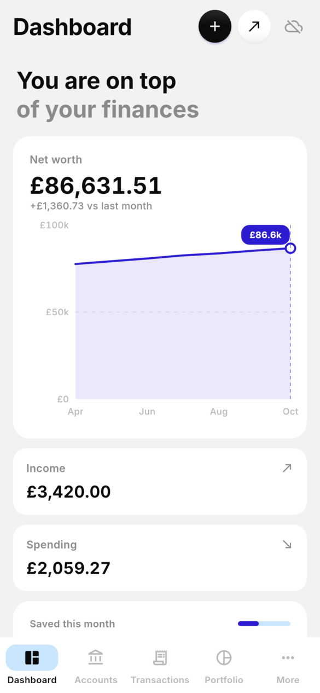
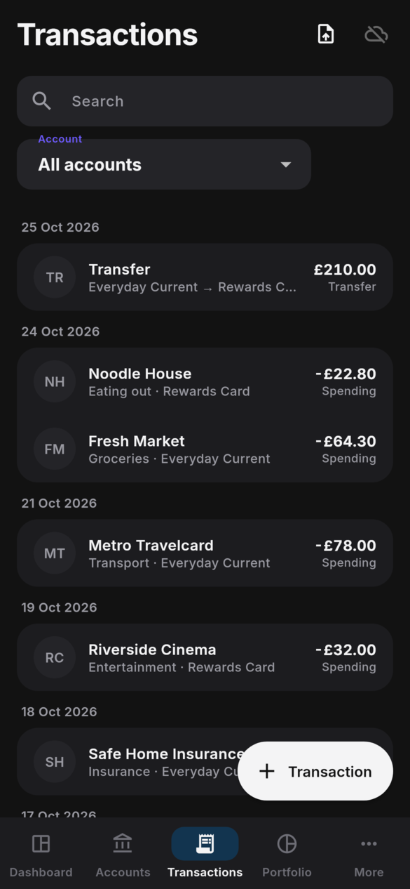
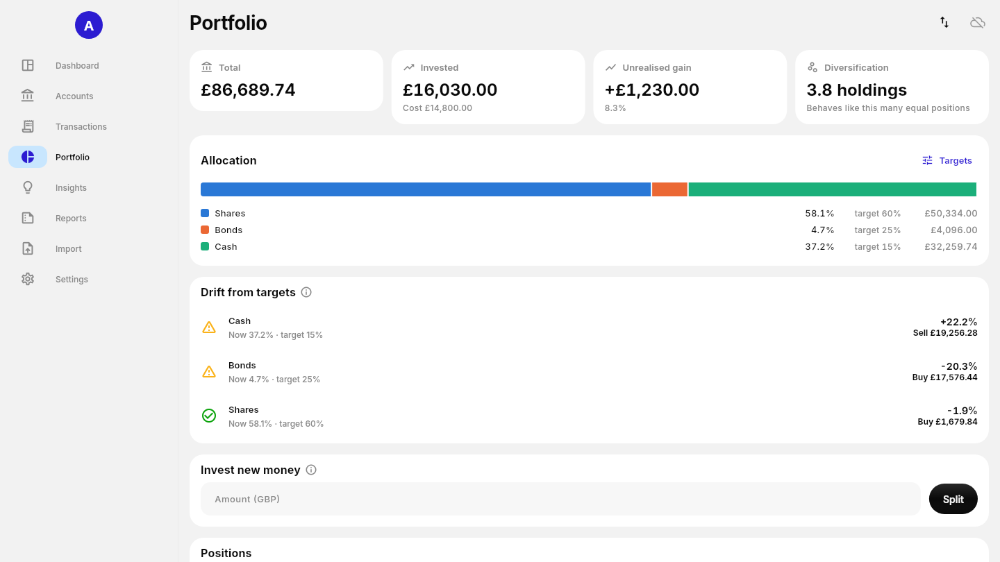

<h1 align="center">
  <br>
  <a href="https://github.com/sudharamachandranrajeev/artha"></a>
  <br>
  Artha
  <br>
</h1>

<h4 align="center">Personal finance, accounting and investment manager for Linux, Windows 11 and Android, with an encrypted local ledger and end-to-end encrypted sync.</h4>

<p align="center">
  <a href="https://github.com/sudharamachandranrajeev/artha/releases"></a>
  
  
  
  
</p>

<p align="center">
  <a href="#key-features">Key Features</a> •
  <a href="#how-to-use">How To Use</a> •
  <a href="#download">Download</a> •
  <a href="#credits">Credits</a> •
  <a href="#related">Related</a> •
  <a href="#license">License</a>
</p>

<p align="center">
  
</p>

Artha is the first module of a wider life-management system (the Brahma suite). Status: **beta**, for
testing on Linux, Windows and Android. New to Artha? Follow the [five-minute quick start](docs/quick-start.md).

## Key Features

* **Accounts in any currency** – bank, cards, savings, ISAs, brokerage, crypto, loans; multi-currency
  double-entry transactions and transfers.
* **Investments** – buys and sells with pooled cost, a portfolio view with target allocation, drift and
  rebalancing, and a split for new money.
* **Statement import** – CSV, OFX, QFX, QIF and PDF statements, with duplicate, overlap and transfer
  matching, statement tallies against printed balances, categorisation rules and payee renames, and a
  "To review" queue.
* **Reports** – balance sheet, income statement and trial balance.
* **Budgets, bills and forecast** – monthly budgets, recurring payments and subscriptions, upcoming bills,
  a 90-day cash-flow forecast and planned one-off payments or receipts.
* **Insights** – insights that learn from your feedback, live Bank of England Bank Rate, ONS inflation and
  money headlines (public downloads only, can be switched off), risk checks, stress tests and a
  safety-first plan.
* **Ask Artha** – an optional assistant that uses your own Anthropic API key, kept in the system keychain;
  it sees rounded figures without names.
* **Encrypted on the device** – local data lives in an encrypted SQLite database (SQLite3MultipleCiphers,
  ChaCha20-Poly1305).
* **End-to-end encrypted sync** – login and cross-device sync through a self-hosted PocketBase server that
  only ever sees ciphertext; pair a new device with a QR code.
* **Friendly** – hints on every control, light and dark themes and several colour palettes.

> [!IMPORTANT]
> On Linux the database key lives in the desktop keyring (libsecret), which must be running and unlocked.
> If the key is missing while a database exists, Artha stops rather than create a new key, so the old
> database stays recoverable.

## Screenshots

<table>
  <tr>
    <td align="center"><br><sub>Dashboard</sub></td>
    <td align="center"><br><sub>Accounts</sub></td>
    <td align="center"><br><sub>Transactions (dark)</sub></td>
  </tr>
  <tr>
    <td align="center"><br><sub>Portfolio</sub></td>
    <td align="center"><br><sub>Insights</sub></td>
    <td align="center"><br><sub>Reports</sub></td>
  </tr>
</table>

<p align="center">
  <br>
  <sub>Portfolio on a desktop window</sub>
</p>

The screenshots are rendered from the current code by `test/screenshots_test.dart` with a made-up
household's data.

## How To Use

To clone and run this application, you'll need [Git](https://git-scm.com) and
[Flutter](https://flutter.dev) installed (Artha is built with Flutter 3.47.7):

```bash
# Clone this repository
$ git clone https://github.com/sudharamachandranrajeev/artha

# Go into the repository
$ cd artha

# Install dependencies
$ flutter pub get

# Run the app
$ flutter run -d linux
```

```bash
# Check and test
$ flutter analyze && flutter test

# Render the main pages to PNG (light, dark and a desktop window)
$ ARTHA_SHOTS=/tmp/artha-shots flutter test test/screenshots_test.dart

# Regenerate the app icons from branding/artha.svg
$ scripts/make-icons.sh
```

<details>
<summary>Tests, CI and the sync server</summary>

- The live tests (`test/*live_test.dart`) also run against a real sync server when one is configured; see
  [server/README.md](server/README.md).
- CI runs everything, including those, on each push; a `v*` tag builds, smoke-tests and publishes the
  Android, Windows and Linux builds (`.github/workflows/release.yml`).
- The sync server is self-hosted PocketBase with end-to-end encryption: setup, HTTPS, recovery and limits
  are in [server/README.md](server/README.md). For development, run `scripts/run-local-server.sh`.
- Artha currently ships native apps. The [web feasibility and Hetzner assessment](docs/web-and-hosting.md)
  describes what browser support needs and compares hosting options; it is a plan, not a web release.

</details>

## Download

Builds are on the [releases page](https://github.com/sudharamachandranrajeev/artha/releases). Each release
has `SHA256SUMS.txt`.

* **Linux (x86-64)** – use the [single-script installer](docs/install-linux.md), including on Arch and
  Omarchy. It downloads a release, checks its checksum, offers to install missing desktop libraries and
  adds Artha to the app menu. From this checkout: `bash scripts/install-linux.sh --download` (needs the
  GitHub CLI, `gh`, signed in; run it as your normal user, without `sudo`). Or unpack
  `Artha-<version>-linux-x64.tar.gz` and run `bash install.sh`. It installs for your user only
  (`~/.local/lib/artha`, a menu entry and `artha` on the PATH); `bash install.sh --uninstall` removes it.
  Needs GTK 3, libsecret and a running keyring. From a checkout:
  `flutter build linux --release && scripts/install-linux.sh`.
* **Windows 10/11** – run `Artha-<version>-windows-x64-setup.exe` (no admin rights needed), or unzip the
  portable build anywhere. Windows SmartScreen warns because the build is not code-signed:
  *More info > Run anyway*.
* **Android 7+** – install `Artha-<version>-android.apk` (allow installs from your browser or file manager
  when asked). Updates install over the top, keeping your data.

Your data stays on the device, encrypted, until you turn on sync. Uninstalling does not delete it on Linux
or Windows (`~/.local/share/dev.artha.artha`, `%APPDATA%\Artha`); on Android it goes with the app, so sync
first.

<details>
<summary>Try sync between devices</summary>

Run a server on your own network: `ARTHA_PB_HOST=0.0.0.0 scripts/run-local-server.sh`, then in Artha choose
*Settings > Sync > Create account* with the address it prints and the invite code from `server/.env`. Other
devices use *Sign in*. Plain `http://` works only for private addresses (home network, Tailscale); anything
public needs HTTPS, see [server/README.md](server/README.md).

</details>

## Credits

This software uses the following open source packages and services:

- [Flutter](https://flutter.dev) and [Riverpod](https://riverpod.dev)
- [drift](https://drift.simonbinder.eu) over [SQLite3MultipleCiphers](https://utelle.github.io/SQLite3MultipleCiphers/)
  (via [sqlite3](https://pub.dev/packages/sqlite3)) for the encrypted database
- [PocketBase](https://pocketbase.io) for the sync server, with [cryptography](https://pub.dev/packages/cryptography)
  for end-to-end encryption
- [fl_chart](https://pub.dev/packages/fl_chart) for charts, [pdfrx](https://pub.dev/packages/pdfrx) (PDFium)
  for PDF statements, [xml](https://pub.dev/packages/xml), [qr](https://pub.dev/packages/qr),
  [flutter_secure_storage](https://pub.dev/packages/flutter_secure_storage),
  [file_picker](https://pub.dev/packages/file_picker), [url_launcher](https://pub.dev/packages/url_launcher)
- [Inter](https://rsms.me/inter/) font
- Exchange rates: European Central Bank reference rates via [Frankfurter](https://frankfurter.dev)
- Live rates and news: Bank of England, ONS, FCA, HMRC, MoneySavingExpert and BBC Business public feeds
- [Claude](https://www.anthropic.com/claude) by Anthropic for the optional Ask Artha assistant

## Related

* [brahma](https://github.com/sudharamachandranrajeev/brahma) – the shared core of the Brahma apps
* [graha-anveshana](https://github.com/sudharamachandranrajeev/graha-anveshana) – property search
* [vahana-anveshana](https://github.com/sudharamachandranrajeev/vahana-anveshana) – car search
* [udyoga](https://github.com/sudharamachandranrajeev/udyoga) – career and job hunting
* [vidya](https://github.com/sudharamachandranrajeev/vidya) – learning, flashcards and focus

## License

No licence has been chosen yet; all rights reserved.

---

> GitHub [@sudharamachandranrajeev](https://github.com/sudharamachandranrajeev)
