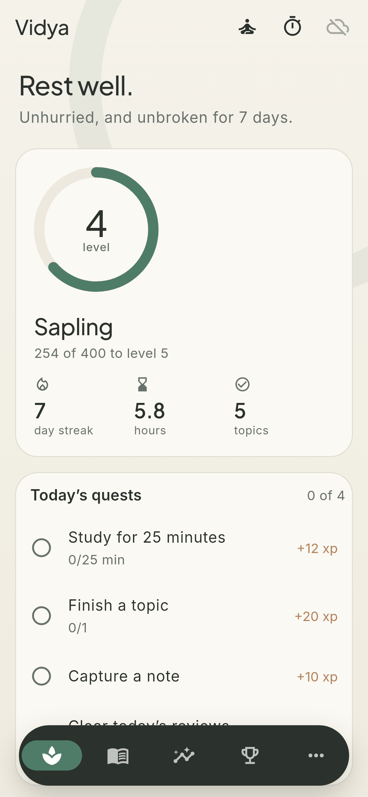
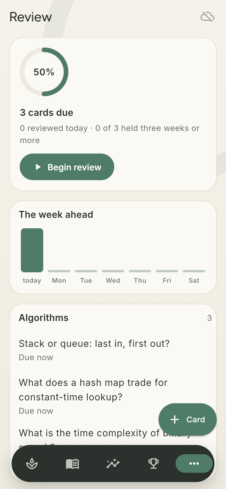
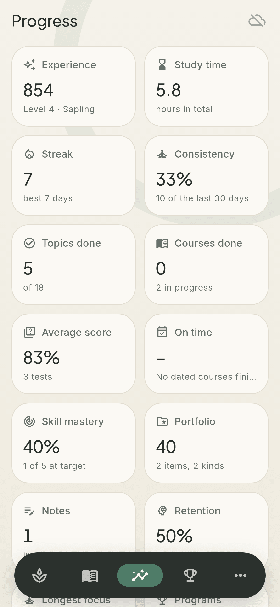
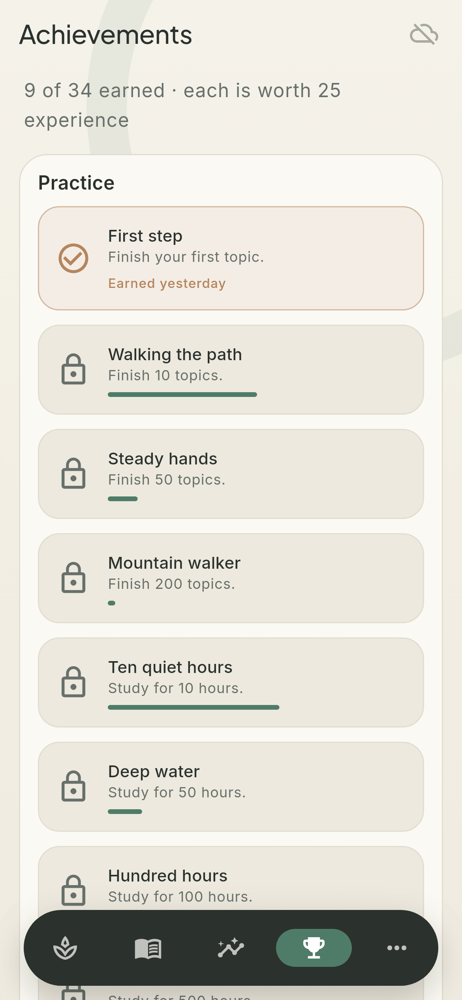
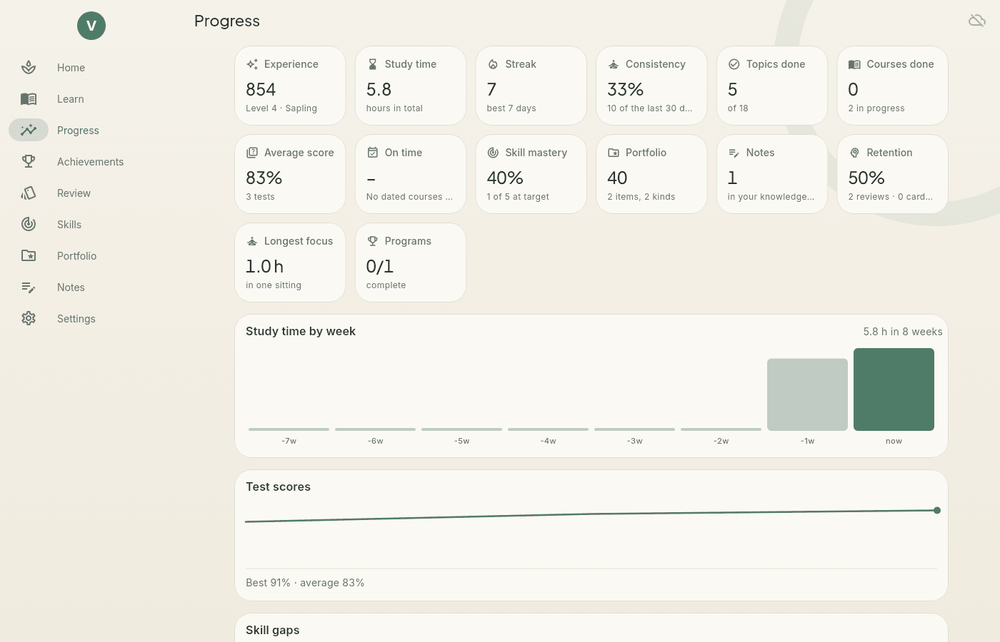

<h1 align="center">
  <br>
  <a href="https://github.com/sudharamachandranrajeev/vidya"></a>
  <br>
  Vidya
  <br>
</h1>

<h4 align="center">A calm learning, knowledge and career-training manager for Linux, Windows and Android, gamified quietly.</h4>

<p align="center">
  <a href="https://github.com/sudharamachandranrajeev/vidya/releases"></a>
  
  
  
</p>

<p align="center">
  <a href="#key-features">Key Features</a> •
  <a href="#how-to-use">How To Use</a> •
  <a href="#download">Download</a> •
  <a href="#credits">Credits</a> •
  <a href="#related">Related</a> •
  <a href="#license">License</a>
</p>

<p align="center">
  
</p>

## Key Features

Plan a curriculum, study it topic by topic, record tests, grow your skills, show your work, keep
notes, and watch every measure of progress. The structure follows the education module of ERPNext
(Program, Course, Topic, Assessment), with the parts a self-learner needs added.

* **Learn** – a *program* is a goal. It holds *courses* (course, book, certification, degree,
  project, practice), each with *topics*. Tick topics off and the course moves on by itself; finish
  every course and the program completes. Start from a template (Software engineer, Data analyst,
  Cloud and DevOps) or write your own.
* **Study log and focus timer** – log minutes against a course, or run a quiet 15 to 60 minute focus
  timer that logs the time when it ends. Record tests with a score and maximum.
* **Review** – flashcards in decks, scheduled by spaced repetition (a day-granular SM-2): Again brings
  a card back today, Good and Easy push it further out each time. Shows what is due, the week ahead
  and your 30-day retention.
* **Skills** – rate each skill 0 to 5 and set a target. The gap is your to-do list.
* **Portfolio** – projects, certificates, publications, talks, contributions and degrees, each tied to
  the skills it proves. A score rewards volume, variety and skills with evidence. Copy it all (skills,
  work, finished courses) as Markdown for a CV or profile.
* **Notes** – a searchable, tagged knowledge base.
* **Progress** – experience, study time, streak and longest streak, 30-day consistency, topics and
  courses done, average and best score and the score trend, on-time rate, skill mastery and gaps,
  portfolio strength, flashcard retention, longest focus, weekly study chart and time by course. All
  worked out from the rows; nothing is typed in by hand.
* **Quests and achievements** – small daily quests (study 25 minutes, finish a topic, capture a note,
  clear the review queue once you have cards), experience, levels from Seed to Sage, a streak and 34
  achievements that unlock once and stay.
* **Zen look** – washi paper and stone with moss and clay, hairline borders, an ensō behind the page,
  short slow motion that stops when the system asks for reduced motion, light and dark.
* **Private by design** – encrypted local database (SQLite3MultipleCiphers), optional end-to-end
  encrypted sync through your own PocketBase server, one account across every Brahma app. Vidya makes
  no network requests of its own.

<details>
<summary><b>How experience works</b></summary>

Experience comes from topics, study time (capped per day), tests, courses, programs, skill levels,
portfolio, notes, cards and reviews (capped per day) and achievements. Level *n* starts at
50·n·(n−1) experience; ranks run from Seed to Sage. Achievements unlock once and stay.
</details>

## Screenshots

<table>
  <tr>
    <td align="center"><br><sub>Home</sub></td>
    <td align="center"><br><sub>Review</sub></td>
    <td align="center"><br><sub>Progress</sub></td>
    <td align="center"><br><sub>Achievements</sub></td>
    <td align="center"><br><sub>Home (dark)</sub></td>
  </tr>
</table>

<p align="center">
  <br>
  <sub>Progress on desktop</sub>
</p>

## How To Use

To clone and run this application, you'll need [Git](https://git-scm.com) and
[Flutter](https://flutter.dev) 3.47 installed:

```bash
# Clone this repository
$ git clone https://github.com/sudharamachandranrajeev/vidya

# Go into the repository
$ cd vidya

# Install dependencies and generate the database code
$ flutter pub get
$ dart run build_runner build -d

# Run the app
$ flutter run -d linux

# Test and format
$ flutter test
$ dart format -l 110 lib test

# Render the pages to PNG with the real fonts
$ VIDYA_SHOTS=/tmp/shots flutter test test/screenshots_test.dart
```

`brahma_core` comes from the [brahma](https://github.com/sudharamachandranrajeev/brahma) repository.
To work on it locally, add a gitignored `pubspec_overrides.yaml` pointing at `../brahma/core`.
`scripts/install-linux.sh` installs a build from a checkout into your app menu.

## Download

Builds are on the [releases page](https://github.com/sudharamachandranrajeev/vidya/releases), each
with `SHA256SUMS.txt`. See the [changelog](CHANGELOG.md) for what is new.

* **Linux (x86-64)** – unpack `Vidya-<version>-linux-x64.tar.gz` and run `./install.sh` to add Vidya
  to your app menu (no root needed; `./install.sh --uninstall` removes it, your data stays). Needs
  GTK 3, libsecret and a running keyring.
* **Windows 10/11** – run `Vidya-<version>-windows-x64-setup.exe`, or unzip the portable build.
* **Android 7+** – install `Vidya-<version>-android.apk`.

## Credits

This software uses the following open source packages and services:

- [Flutter](https://flutter.dev) and [Riverpod](https://riverpod.dev)
- [drift](https://drift.simonbinder.eu) over [SQLite3MultipleCiphers](https://utelle.github.io/SQLite3MultipleCiphers/) for the encrypted database
- [PocketBase](https://pocketbase.io) for optional self-hosted sync
- [url_launcher](https://pub.dev/packages/url_launcher) and [intl](https://pub.dev/packages/intl)
- The [ERPNext](https://erpnext.com) education module, as the model for programs, courses and topics
- Fonts [Inter](https://rsms.me/inter/) and [Plus Jakarta Sans](https://github.com/tokotype/PlusJakartaSans), bundled under the SIL Open Font License

## Related

Vidya is part of **Brahma**, a suite of life-management apps that share one encrypted account:

* [brahma](https://github.com/sudharamachandranrajeev/brahma) – the shared core and the all-in-one Brahma app
* [Artha](https://github.com/sudharamachandranrajeev/artha) – personal finance
* [Udyoga](https://github.com/sudharamachandranrajeev/udyoga) – career and job search
* [Graha Anveshana](https://github.com/sudharamachandranrajeev/graha-anveshana) – property search
* [Vahana Anveshana](https://github.com/sudharamachandranrajeev/vahana-anveshana) – car search

## License

No licence has been chosen yet; all rights reserved.

---

> GitHub [@sudharamachandranrajeev](https://github.com/sudharamachandranrajeev)
