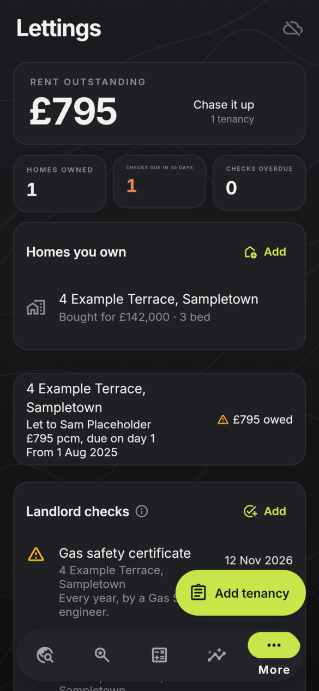
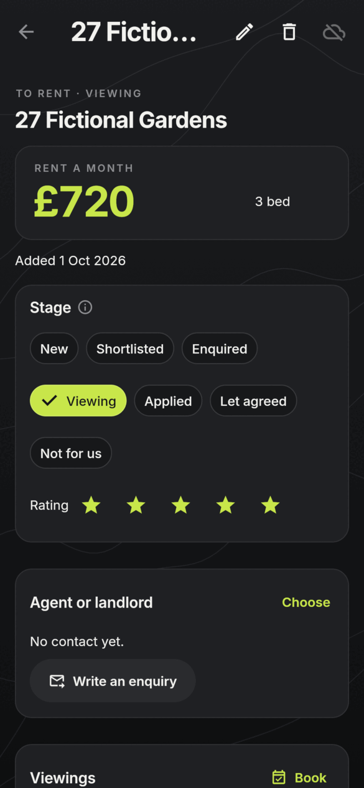
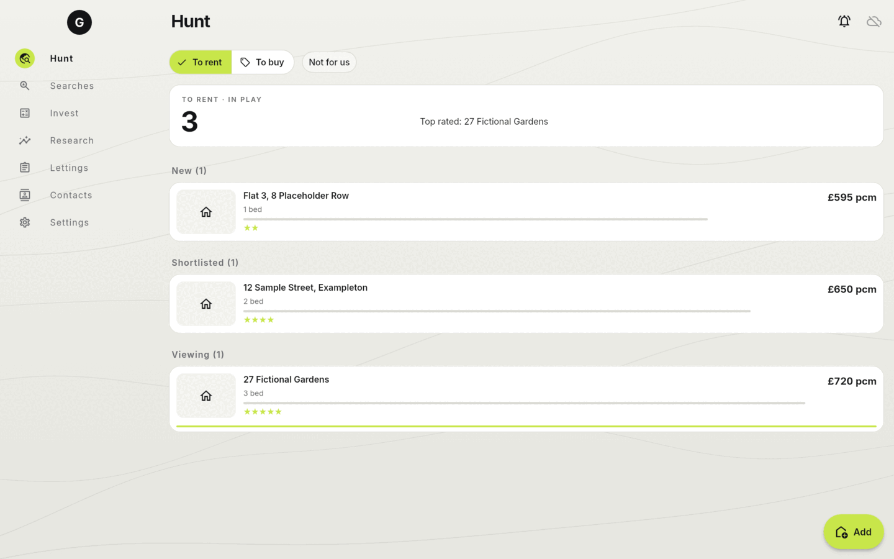
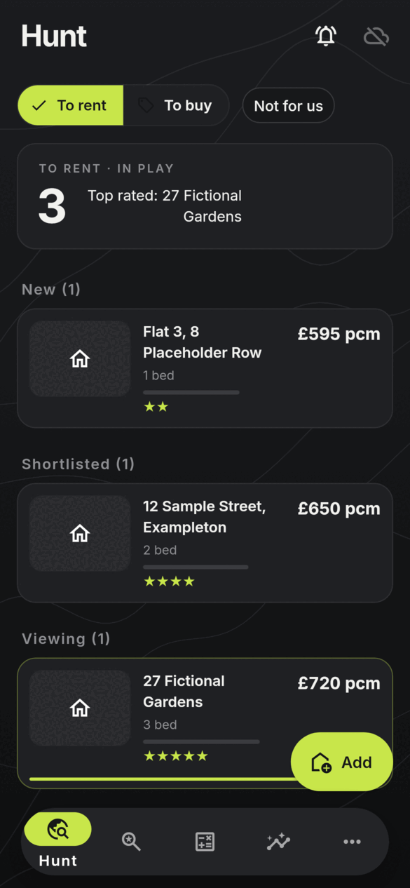
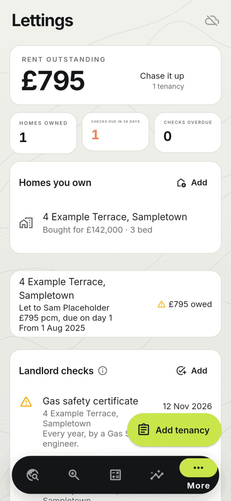
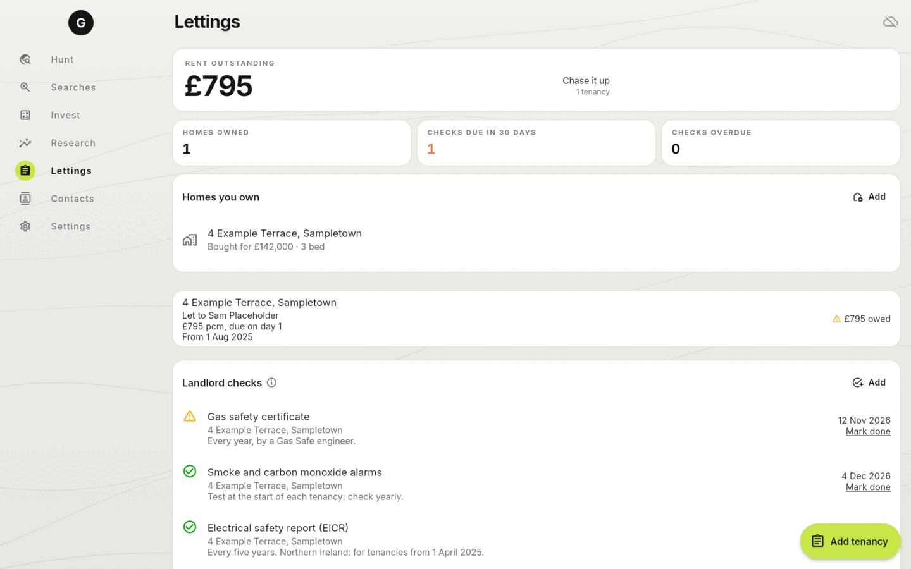

<h1 align="center">
  <br>
  <a href="https://github.com/sudharamachandranrajeev/graha-anveshana"></a>
  <br>
  Graha Anveshana
  <br>
</h1>

<h4 align="center">Property search, renting, buying, investment, development and lettings, for Linux, Windows 11 and Android.</h4>

<p align="center">
  <a href="https://github.com/sudharamachandranrajeev/graha-anveshana/releases"></a>
  
  
  
</p>

<p align="center">
  <a href="#key-features">Key Features</a> •
  <a href="#how-to-use">How To Use</a> •
  <a href="#download">Download</a> •
  <a href="#brahma-watch-phone-alerts">Brahma Watch</a> •
  <a href="#credits">Credits</a> •
  <a href="#related">Related</a> •
  <a href="#license">License</a>
</p>

<p align="center">
  
</p>

Graha Anveshana is part of **Brahma**, a suite of life-management apps that share one encrypted
account. Status: early releases, for testing. Local data lives in an encrypted SQLite database
(SQLite3MultipleCiphers); sync through your own PocketBase server is optional and end-to-end
encrypted.

## Key Features

* **Hunt** – every property you are considering, to rent or to buy, grouped by stage (new,
  shortlisted, enquired, viewing, applied, agreed). Add one from a PropertyPal link (an advert or
  a whole search page) or by hand. Distances are measured from your home point; adverts that go
  let or sold are flagged.
* **Contact** – call, text, WhatsApp or e-mail agents and landlords from the app; each is logged
  against the property and moves it along. A ready-made first enquiry (is it free, what next, when
  to view) is signed with your details from Settings. Viewings and follow-ups are kept with it.
* **Alerts** – saved searches run in the cloud on [Brahma Watch](#brahma-watch-phone-alerts), which
  pushes new listings, price drops and status changes to your phone through ntfy. The app sends it
  your searches and pulls in what it found.
* **Invest** – appraisals with current UK rules:
  * *Buy-to-let:* purchase tax with the surcharges, yields, cash flow, Section 24, company
    ownership, lender stress test, break-even rent, equity over time.
  * *Buying a home:* affordability, stressed payments, cost of owning against renting, letting later.
  * *Small developments:* GDV, build, finance, profit and residual land value.
  * Save appraisals to compare.
* **Research** – a report for any UK postcode from open data: UK House Price Index for the council
  area and the nation, street-level crime (police.uk; not Scotland) and sold prices (Price Paid;
  England and Wales). Links for flood risk, EPCs, planning, broadband and rents, per nation. A
  purchase tax calculator (SDLT, LBTT, LTT) and a development checklist.
* **Lettings** – tenancies as landlord or tenant, rent due and received with arrears, deposits,
  and landlord checks (gas, EICR, EPC, alarms, registration...) that come round again when done.
* **Instrument-panel look** – charcoal canvas with faint contour lines, hairline cards, one lime
  accent, big tabular figures; light and dark; Inter bundled.
* **Private by default** – data stays on the device, encrypted, until you turn on sync. An account
  made in any Brahma app works in all of them.

Tax rates are as of October 2026 and are a starting point for your own checks, not advice.

## Screenshots

<table>
  <tr>
    <td align="center"><br><sub>Hunt</sub></td>
    <td align="center"><br><sub>Invest (buy-to-let)</sub></td>
    <td align="center"><br><sub>Lettings (dark)</sub></td>
    <td align="center"><br><sub>A property (dark)</sub></td>
  </tr>
</table>

<p align="center">
  <br><sub>Hunt on the desktop</sub>
</p>

<details>
<summary>More screenshots</summary>

<table>
  <tr>
    <td align="center"><br><sub>Hunt (dark)</sub></td>
    <td align="center"><br><sub>Invest (dark)</sub></td>
    <td align="center"><br><sub>Lettings</sub></td>
    <td align="center"><br><sub>A property</sub></td>
  </tr>
</table>

<br><sub>Lettings on the desktop</sub>

</details>

All screenshots are rendered from the current code with made-up homes and people
(`test/screenshots_test.dart`).

## How To Use

To clone and run this application, you'll need [Git](https://git-scm.com) and
[Flutter](https://flutter.dev) 3.47 installed:

```bash
# Clone this repository
$ git clone https://github.com/sudharamachandranrajeev/graha-anveshana

# Go into the repository
$ cd graha-anveshana

# Install dependencies
$ flutter pub get

# Run the app
$ flutter run -d linux
```

`brahma_core` comes from the [brahma](https://github.com/sudharamachandranrajeev/brahma)
repository. To work on both at once, add a `pubspec_overrides.yaml` (ignored by git):

```yaml
dependency_overrides:
  brahma_core:
    path: ../brahma/core
```

```bash
# Analyse and test
$ flutter analyze && flutter test

# Render the screenshots (light, dark and desktop) into a folder
$ GRAHA_SHOTS=/tmp/shots flutter test test/screenshots_test.dart
```

CI runs analyse and test on each push; a `v*` tag builds, smoke-tests and publishes the Android,
Windows and Linux builds (`.github/workflows/release.yml`). `scripts/make-icons.sh` regenerates
the icons from `branding/anveshana.svg`.

## Download

Builds are on the [releases page](https://github.com/sudharamachandranrajeev/graha-anveshana/releases),
each with `SHA256SUMS.txt`.

* **Linux (x86-64):** unpack `Graha-Anveshana-<version>-linux-x64.tar.gz` and run `./install.sh`
  (for your user only; `./install.sh --uninstall` removes it). Needs GTK 3, libsecret and a running
  keyring, which holds the database key.
* **Windows 10/11:** run `Graha-Anveshana-<version>-windows-x64-setup.exe` (no admin rights), or
  unzip the portable build. SmartScreen warns because the build is not code-signed:
  *More info > Run anyway*.
* **Android 7+:** install `Graha-Anveshana-<version>-android.apk`.

## Brahma Watch (phone alerts)

[Brahma Watch](https://github.com/sudharamachandranrajeev/brahma/tree/main/watch) is a Cloudflare
Worker on your own account that runs your saved searches.

1. In a checkout of [brahma](https://github.com/sudharamachandranrajeev/brahma): `cd watch`,
   `npm install`, `npx wrangler login`, `npm run setup`. It deploys the Worker to your Cloudflare
   account and keeps its address, API token and ntfy topic in `~/.config/brahma/watch.env`.
2. Install ntfy on your phone and subscribe to that topic.
3. In Graha Anveshana: *Settings > Brahma Watch*, enter the address and the API token. Then
   *Searches* to send or copy searches, and *Test alert* to check the phone gets it.

## Credits

This software uses the following open source packages and services:

* [Flutter](https://flutter.dev) with [Riverpod](https://riverpod.dev)
* [drift](https://drift.simonbinder.eu) over SQLite3MultipleCiphers (via brahma_core)
* [http](https://pub.dev/packages/http), [intl](https://pub.dev/packages/intl),
  [url_launcher](https://pub.dev/packages/url_launcher)
* [Inter](https://rsms.me/inter/) typeface (SIL Open Font License, `assets/fonts/Inter-OFL.txt`)
* [PocketBase](https://pocketbase.io) for optional sync; [ntfy](https://ntfy.sh) and
  [Cloudflare Workers](https://workers.cloudflare.com) for Brahma Watch
* Open data: [UK House Price Index](https://www.gov.uk/government/collections/uk-house-price-index-reports),
  [police.uk](https://data.police.uk), [Price Paid Data](https://www.gov.uk/government/collections/price-paid-data),
  [postcodes.io](https://postcodes.io)

## Related

* [Vahana Anveshana](https://github.com/sudharamachandranrajeev/vahana-anveshana) – the sibling app for cars
* [Artha](https://github.com/sudharamachandranrajeev/artha) – Brahma's personal-finance app
* [Udyoga](https://github.com/sudharamachandranrajeev/udyoga) – Brahma's career app
* [Vidya](https://github.com/sudharamachandranrajeev/vidya) – Brahma's learning app
* [brahma](https://github.com/sudharamachandranrajeev/brahma) – the shared core and Brahma Watch

## License

No licence has been chosen yet; all rights reserved. Inter is under the SIL Open Font License.

---

> GitHub [@sudharamachandranrajeev](https://github.com/sudharamachandranrajeev)
