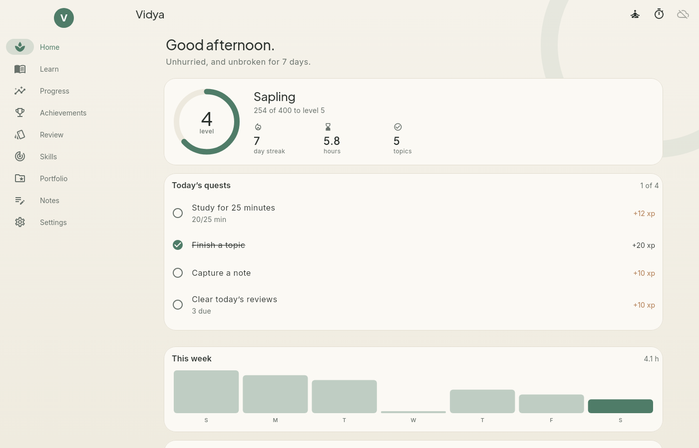

# Vidya

A calm learning, knowledge and career-training manager for Linux, Windows 11 and Android. Plan a
curriculum, study it topic by topic, record tests, grow your skills, show your work, keep notes, and
watch every measure of progress. Gamified quietly: experience, levels, a streak, daily quests and 28
achievements. Part of **Brahma**, a suite of life-management apps that share one encrypted account
(with [Artha](https://github.com/sudharamachandranrajeev/artha),
[Anveshana](https://github.com/sudharamachandranrajeev/anveshana) and
[Udyoga](https://github.com/sudharamachandranrajeev/udyoga)). The shared core lives in
[brahma](https://github.com/sudharamachandranrajeev/brahma).

Built with Flutter 3.47.7. Local data in an encrypted SQLite database (SQLite3MultipleCiphers);
optional end-to-end encrypted sync through your own PocketBase server. Vidya makes no network
requests of its own.

<p>
  
  
  
</p>



## What it does

The structure follows the education module of ERPNext (Program, Course, Topic, Assessment), with
the parts a self-learner needs added.

- **Learn.** A *program* is a goal. It holds *courses* (course, book, certification, degree,
  project, practice), each with *topics*. Tick topics off and the course moves on by itself; finish
  every course and the program completes. Start from a template (Software engineer, Data analyst,
  Cloud and DevOps) or write your own.
- **Study log and focus timer.** Log minutes against a course, or run a quiet 15 to 60 minute
  focus timer that logs the time when it ends. Record tests with a score and maximum.
- **Review.** Flashcards in decks, scheduled by spaced repetition (a day-granular SM-2): Again
  brings a card back today, Good and Easy push it further out each time. Shows what is due, the
  week ahead and your 30-day retention.
- **Skills.** Rate each skill 0 to 5 and set a target. The gap is your to-do list.
- **Portfolio.** Projects, certificates, publications, talks, contributions and degrees, each tied
  to the skills it proves. A score rewards volume, variety and skills with evidence. Copy it all
  (skills, work, finished courses) as Markdown for a CV or profile.
- **Notes.** A searchable, tagged knowledge base.
- **Progress.** Experience, study time, streak and longest streak, 30-day consistency, topics and
  courses done, average and best score and the score trend, on-time rate, skill mastery and gaps,
  portfolio strength, flashcard retention, longest focus, weekly study chart and time by course. All worked out from the rows; nothing
  is typed in by hand.
- **Quests and achievements.** Small quests each day (study 25 minutes, finish a topic, capture a
  note, and clear the review queue once you have cards). Experience comes from topics, study time
  (capped per day), tests, courses, programs, skill levels, portfolio, notes, cards and reviews
  (capped per day) and achievements. 34 achievements. Level *n* starts at 50·n·(n−1) experience; ranks run
  from Seed to Sage. Achievements unlock once and stay.
- **Zen look.** Washi paper and stone with moss and clay, hairline borders, an ensō behind the page,
  short slow motion that stops when the system asks for reduced motion, light and dark.

## Install

Releases carry an Android APK, a Windows installer and a Linux tarball. On Linux, `./install.sh`
inside the tarball adds Vidya to the app menu. Or `scripts/install-linux.sh` from a checkout.

## Develop

```
flutter pub get
dart run build_runner build -d
flutter test
dart format -l 110 lib test
```

`VIDYA_SHOTS=<dir> FLUTTER_ROOT=... flutter test test/screenshots_test.dart` renders the pages to
PNG. To work on brahma_core locally, add a gitignored `pubspec_overrides.yaml` pointing at
`../brahma/core`.
