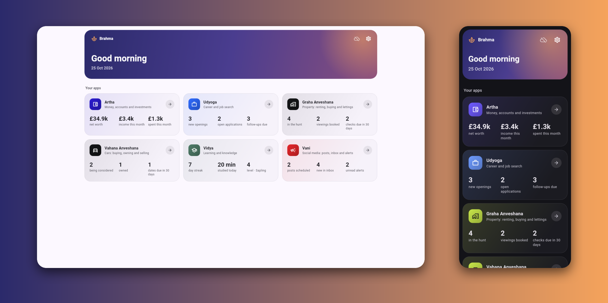
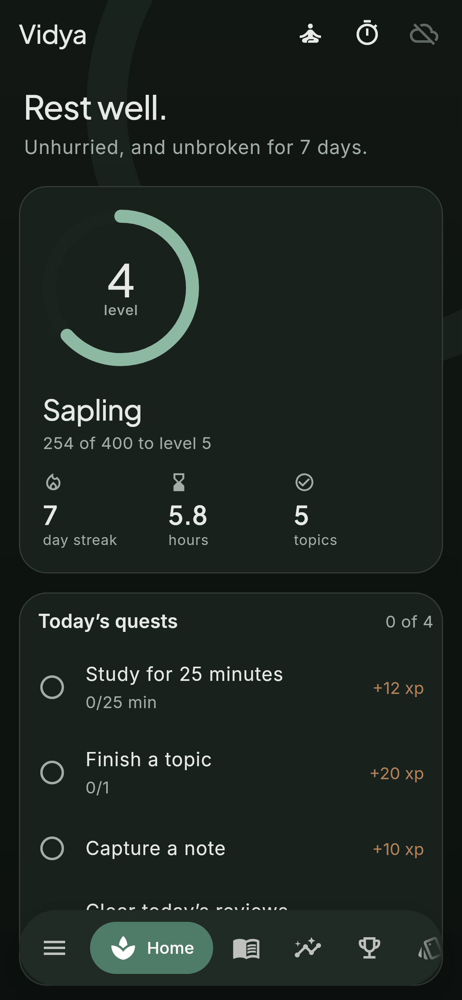
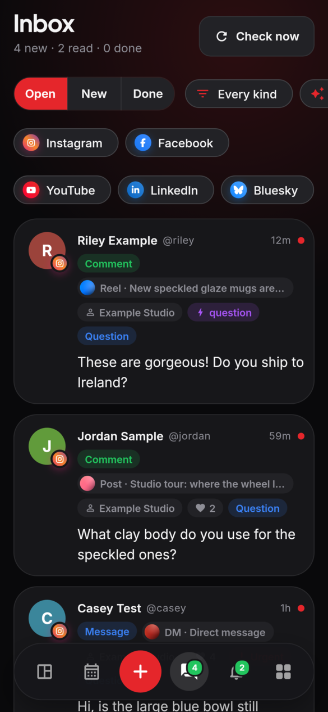
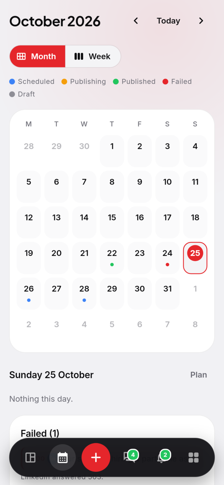
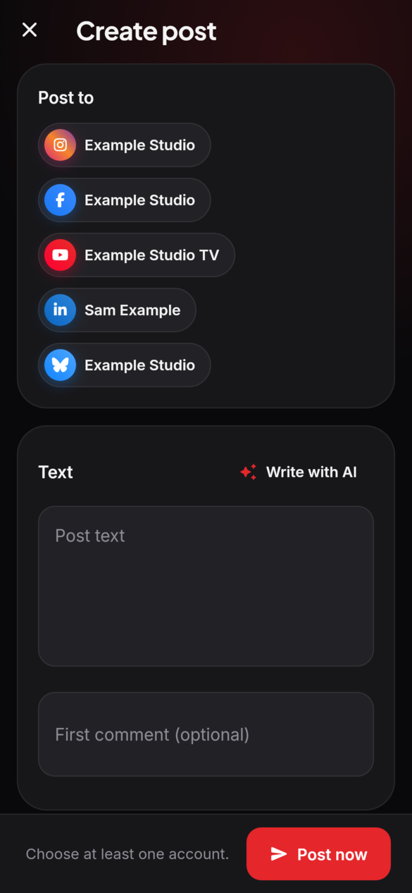
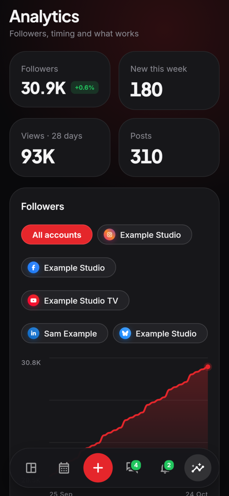
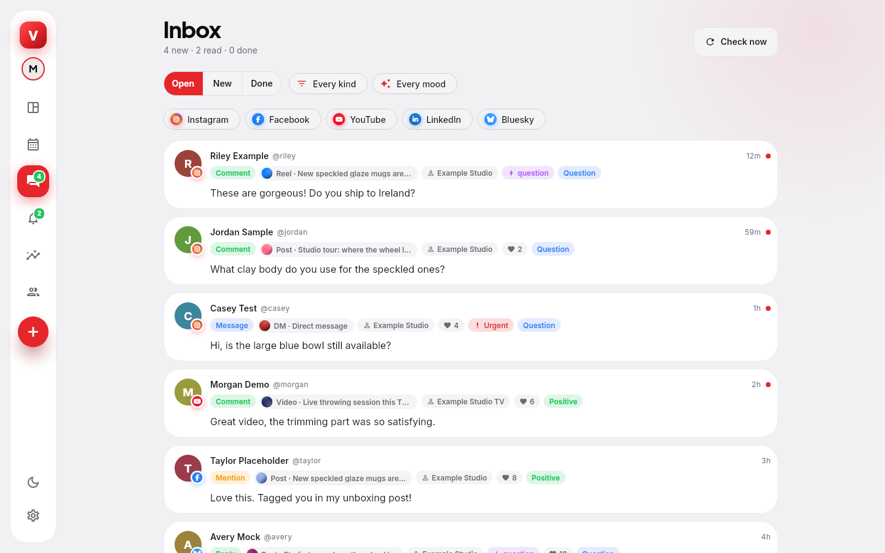

<h1 align="center">
  <br>
  <a href="https://github.com/sudharamachandranrajeev/vani"></a>
  <br>
  Vani
  <br>
</h1>

<h4 align="center">One app to post, schedule and answer across your social accounts, with alerts for what you are looking for. Linux, Windows and Android.</h4>

<p align="center">
  
  
  
  
  
</p>

<p align="center">
  <a href="#key-features">Key Features</a> •
  <a href="#how-to-use">How To Use</a> •
  <a href="#download">Download</a> •
  <a href="#credits">Credits</a> •
  <a href="#related">Related</a> •
  <a href="#license">License</a>
</p>

<p align="center">
  
</p>

Vani ("voice") is the Brahma social media manager for Instagram, Facebook, YouTube, LinkedIn, Threads,
Bluesky, Mastodon and Telegram. It is a Flutter app built on `brahma_core`. The work that has to happen
while your devices are off runs on your own hub (`hub/`, a Cloudflare Worker on your account): it
holds the platform tokens, publishes on schedule, collects comments, messages, mentions and live chat,
runs discovery watches and pushes alerts to your phone. Vani sets it up and updates it; the API is described
in `hub/README.md`.

## Key Features

* **Home** – followers, views, replies and account health at a glance, top content, AI ideas, what is up
  next, today's activity and alerts.
* **Compose** – one post to many accounts with per-account wording, format (post, carousel, reel, story,
  video, short), YouTube title and first comment; live character counts per platform; uploads with
  progress and a media library; alt text on images (yours or drafted by Claude); AI captions and
  hashtags; post now, schedule, queue or save a draft; recycle evergreen posts.
* **Calendar** – month and week views; drag a post to another day to reschedule; failed posts with
  retry, drafts.
* **Inbox** – every comment, reply, DM, mention and live chat message in one place; filters, bulk
  actions, inline replies, private replies to comments, saved replies with `{name}` and AI suggestions.
* **AI triage and translation** – Claude tags new items by mood, priority and language (filter by mood
  or "urgent"), translates them into your language and translates your reply into theirs.
* **Moderation** – hide or delete comments where the platform allows it (Instagram, Facebook, YouTube
  hide, Telegram delete).
* **Alerts** – describe what you want in plain English and Claude drafts a discovery watch over eBay,
  DoneDeal, Instagram hashtags and business accounts, Bluesky and YouTube; you check it before saving.
  Inbox rules alert or auto-reply on keywords. Every Monday a short AI summary of the week arrives as a
  push.
* **Accounts** – connect with OAuth (Meta, Threads, Google, LinkedIn), a Bluesky app password, a
  Mastodon token or a Telegram bot for a channel or group; token health and reconnect; app credentials
  with the redirect URIs and webhooks to paste into each developer console.
* **Analytics** – follower growth, best times to post, per-account numbers and top content.
* **Profiles** – one hub, several workspaces (your own accounts, a business, a client). Each profile has
  its own accounts, posts, inbox, alerts, rules and settings; switch from the rail (or More on a phone)
  and the whole app follows, on that device only.
* **Settings** – the hub address and token (synced end-to-end encrypted between your devices),
  profiles, the posting queue, saved replies, inbox language, AI model, light and dark theme.

> [!NOTE]
> AI features need an Anthropic API key, stored on the hub (*Accounts > App credentials*). App
> credentials and the Anthropic key are shared by all profiles. Profiles share the hub token, so they
> keep things apart, not secret.

## Screenshots

<table>
  <tr>
    <td align="center"><br><sub>Home</sub></td>
    <td align="center"><br><sub>Inbox with AI tags</sub></td>
    <td align="center"><br><sub>Calendar (light)</sub></td>
  </tr>
  <tr>
    <td align="center"><br><sub>Create post</sub></td>
    <td align="center"><br><sub>Analytics</sub></td>
    <td align="center"><br><sub>Inbox on desktop (light)</sub></td>
  </tr>
</table>

The screenshots are rendered from the current code by `test/screenshots_test.dart` with made-up demo
data.

## How To Use

To clone and run this application, you'll need [Git](https://git-scm.com) and
[Flutter](https://flutter.dev) installed, plus a checkout of
[brahma](https://github.com/sudharamachandranrajeev/brahma) next to this one (`pubspec_overrides.yaml`
points `brahma_core` at `../brahma/core`):

```bash
# Clone this repository and the Brahma core beside it
$ git clone https://github.com/sudharamachandranrajeev/vani
$ git clone https://github.com/sudharamachandranrajeev/brahma

# Go into the repository
$ cd vani

# Install dependencies
$ flutter pub get

# Run the app
$ flutter run -d linux
```

Then set up your hub: *Settings > Social hub > Set up a hub* (on a computer, once). Vani walks you
through a free Cloudflare account, switching on R2 and making a key, then deploys the hub itself and
shows a QR code for your phone. *Connect hub* takes an existing hub's address and token instead.

Vani ships the hub's code in `assets/hub`. After changing `hub/`, bump `hub/src/version.ts` and rebuild it:

```bash
$ (cd hub && npm ci && npm test && npm run bundle)
```

```bash
# Check and test
$ flutter analyze
$ flutter test

# Render the main pages to PNG
$ VANI_SHOTS=/tmp/vani-shots flutter test test/screenshots_test.dart

# Regenerate the icons after editing branding/vani.svg
$ scripts/make-icons.sh
```

The tests run the whole app against an in-memory fake hub (`test/fake_hub.dart`) seeded with made-up
data; nothing leaves the machine. CI (`.github/workflows/ci.yml`) runs on each push.

## Download

No builds have been published yet. The release workflow (`.github/workflows/release.yml`) builds an
Android APK, a Windows installer and portable zip, and a Linux tarball, and checks that each one starts;
pushing a `v*` tag publishes them as a GitHub release.

On Linux, `scripts/install-linux.sh` (or `install.sh` inside a release tarball) installs Vani for the
current user, no root needed: the app goes to `~/.local/lib/vani`, a launcher to `~/.local/bin/vani` and
a menu entry to `~/.local/share/applications`. `--uninstall` removes it. Your encrypted data lives in
`~/.local/share/dev.brahma.vani` and its key in the desktop keyring; neither is touched by installing,
upgrading or uninstalling.

## Credits

This software uses the following open source packages and services:

- [Flutter](https://flutter.dev) and [Riverpod](https://riverpod.dev)
- [drift](https://drift.simonbinder.eu), [http](https://pub.dev/packages/http),
  [intl](https://pub.dev/packages/intl), [file_picker](https://pub.dev/packages/file_picker),
  [url_launcher](https://pub.dev/packages/url_launcher)
- [Font Awesome Flutter](https://pub.dev/packages/font_awesome_flutter) for platform brand icons
- [Inter](https://rsms.me/inter/) and [Plus Jakarta Sans](https://github.com/tokotype/PlusJakartaSans)
  fonts (SIL Open Font License)
- [Claude](https://www.anthropic.com/claude) by Anthropic for the AI features
- [Cloudflare Workers](https://workers.cloudflare.com) (D1, R2) for the hub

## Related

* [brahma](https://github.com/sudharamachandranrajeev/brahma) – the shared core of the Brahma apps and
  the hub Vani talks to
* [artha](https://github.com/sudharamachandranrajeev/artha) – personal finance, accounting and investments
* [graha-anveshana](https://github.com/sudharamachandranrajeev/graha-anveshana) – property search
* [vahana-anveshana](https://github.com/sudharamachandranrajeev/vahana-anveshana) – car search
* [udyoga](https://github.com/sudharamachandranrajeev/udyoga) – career and job hunting
* [vidya](https://github.com/sudharamachandranrajeev/vidya) – learning, flashcards and focus

## License

No licence has been chosen yet; all rights reserved.

---

> GitHub [@sudharamachandranrajeev](https://github.com/sudharamachandranrajeev)
