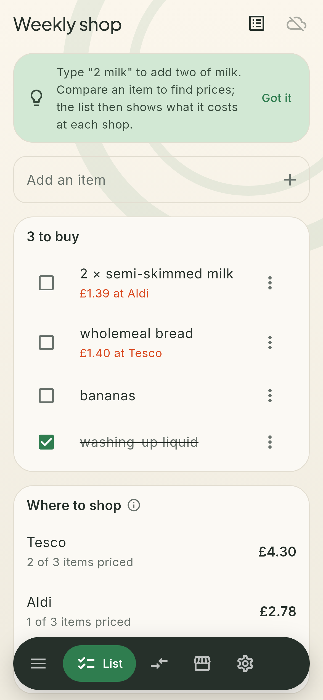
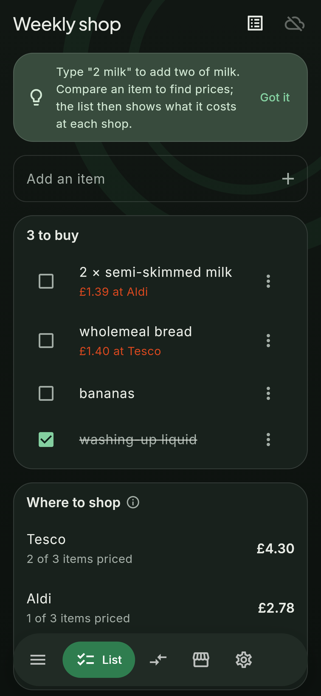
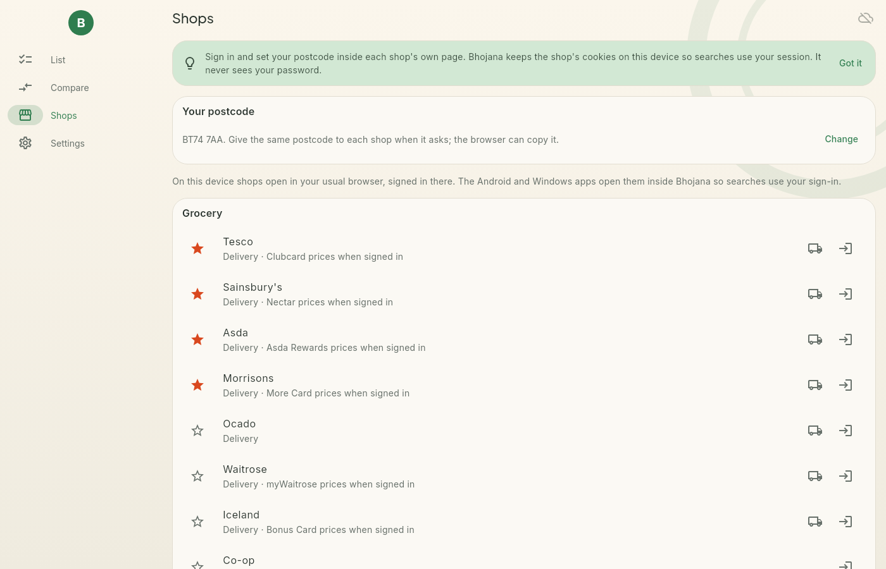

# Bhojana

Grocery and shopping for the UK: shopping lists, price comparison across shops, live prices through
your own shop logins, and basket filling. Part of the [Brahma](https://github.com/sudharamachandranrajeev/brahma)
suite. Linux, Windows and Android.

<p>
  
  
</p>


## What it does

- **Lists.** Type `2 milk` to add two of milk. Tick items off; untick everything for next week.
- **Compare.** Search one product across your starred shops. Bhojana reads each shop's own search page
  and ranks what it finds by match, then price. Keep the prices you want; the list then shows what it
  costs at each shop.
- **Live prices with your login.** Sign in to a shop and set your postcode inside the in-app browser.
  Searches share that browser's cookies, so you see your Clubcard, Nectar or Lidl Plus prices, stock and
  local prices. Bhojana never sees your password and never stores card details.
- **Fill a basket.** Pick a shop and Bhojana walks your list in its site, one item at a time. Press
  the shop's own Add button, or let *Add first* press it. You check out yourself.
- **Delivery slots.** One tap opens a grocer's slot page, signed in.
- **22 shops:** Tesco, Sainsbury's, Asda, Morrisons, Ocado, Waitrose, Iceland, Co-op, Aldi, Lidl, Poundland,
  Poundstretcher, Home Bargains, B&M, HomeSense, TK Maxx, Matalan, Primark, Boots, Superdrug, The Body Shop
  and Sports Direct.

## Platform notes

- Android and Windows have the in-app browser and search for you.
- Linux has no embedded web view for Flutter: shops open in your normal browser and you type in the
  prices you find.
- Big supermarkets block automated browsers. Reading a page you are signed in to usually works. When a
  search comes back empty, open the shop, accept its cookie banner or sign in, and search again.
- Shop sites change. The search addresses live in `lib/domain/shops.dart`, and the price reader is one
  site-agnostic script in `lib/domain/reader.dart`. The script reads schema.org Product data, or product
  links with a £ price on their tile.

## Privacy

The database is encrypted on the device. Sync is optional, to your own server, end-to-end encrypted.
Bhojana contacts shop websites only when you search or open one.

## Development

```sh
flutter pub get
flutter test                       # reader_test runs the price reader in headless Chromium if installed
BHOJANA_SHOTS=/tmp/shots FLUTTER_ROOT=... flutter test test/screenshots_test.dart
flutter build linux --release && scripts/install-linux.sh
```
