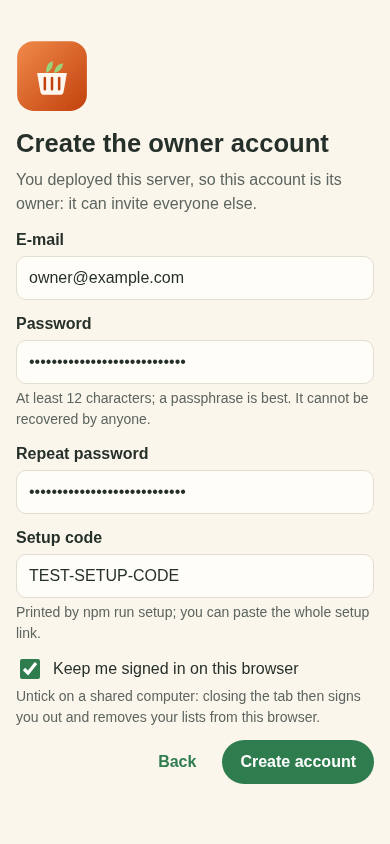
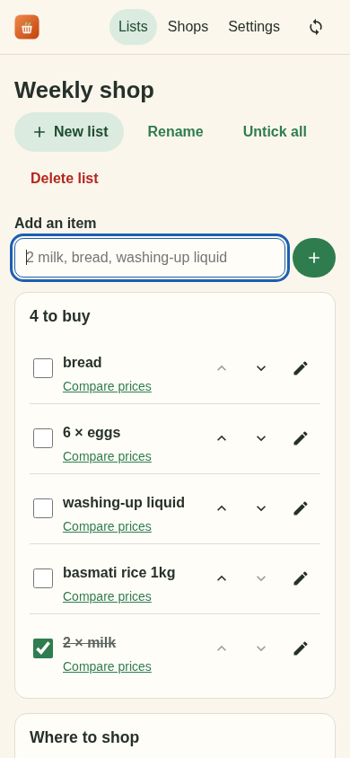
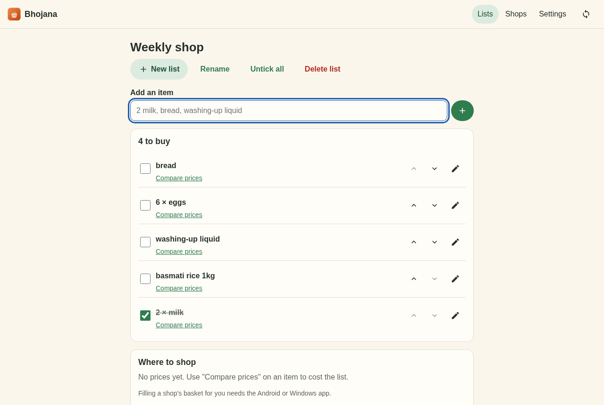

# Bhojana on the web

The web app is one more device on your Bhojana sync account. Your own sync server ([`../server`](../server/README.md))
serves it at its own address, so there is nothing else to host: open `https://bhojana.<your-subdomain>.workers.dev`
in a browser.

It speaks the same protocol and data format as the Android, Windows and Linux apps: the same end-to-end
encryption, the same numbered batches, the same last-writer-wins clock. Lists, items, typed and synced
prices, starred shops and your postcode move between the browser and the apps in both directions.

<p>
  
  
</p>


## What it does

- **Sign up, sign in, or join.** The first account uses the setup code printed by `npm run setup`; later
  ones an invite code from the owner. The recovery key is shown once. You can also join from a device you
  already use: paste (or scan) its pairing link and check the six-digit code matches.
- **Add a device** from Settings: a QR code and a link for the new device, then you approve it.
- **Lists.** Several lists; type `2 milk` to add two of milk; tick, untick everything, reorder, notes.
- **Compare.** Search links open each shop in a new tab; type in the prices you find. A web page cannot
  read other sites, so live prices come from the Android and Windows apps or the Bhojana browser
  extension; they sync here and the list shows what it costs at each shop.
- **Shops.** The 22 shops, starred ones first, your postcode, delivery-slot links.
- **Settings.** Sync status and *Sync now*, devices, change password, sign out, and for the owner: people,
  invite codes and password-reset codes.
- Works offline once loaded (a service worker caches the app; sync catches up when you are back online).
  Installable as an app from the browser menu.

Sync runs when the app opens, about 1.5 seconds after each change, when you come back to the tab (at most
every 30 seconds), when the connection returns, and every 15 minutes.

## Security

The apps keep your session and data key in the operating system's keychain and the database in SQLCipher.
A browser has neither, so the web app is weaker in these ways:

- **Keys in browser storage.** With *Keep me signed in* on, the session token and the data key sit in this
  site's IndexedDB. Anything that can run script on this origin, or read the browser profile on disk, can
  read them. The browser keeps them apart from other sites, but not from malware on the computer or from
  other people who use the same browser profile.
- **Lists are not encrypted at rest.** Your lists are stored in IndexedDB as plain rows (they are encrypted
  before they go to the server, as everywhere else). Sign out on a computer you share.
- **Cross-site scripting is the main threat**, because the page holds the keys. The page is built from
  local code only, Svelte escapes everything it renders (the one raw insert is the pairing QR code, an SVG built locally from
  the link), synced price links are used only if they are
  `http(s)`, and `public/_headers` sets a Content Security Policy that lets only this origin's own scripts
  run (plus WebAssembly, which Argon2id needs), blocks framing and sends no referrer.
- **Untick *Keep me signed in*** on a shared or public computer. The keys are then held in the tab's memory
  only: closing the tab signs you out, and the next visit wipes this browser's copy of your lists.
  Changes that had not synced yet are lost.
- **Sign out** removes the keys and every list from this browser. Your account and other devices keep
  everything.
- The server still never sees your password, data key or lists: the password is stretched with Argon2id in
  the page, and only a derived login secret and ciphertext are sent.

## Develop

Node 24 or newer.

```sh
npm ci
npm test             # crypto vectors against the Dart client, sync E2E against the real handler, lists
npm run typecheck    # svelte-check, warnings fail
npm run build        # into ../server/public, which the Worker serves
npm run smoke        # headless Chromium on the built app; screenshots into docs/
npm run serve        # the built app and an in-memory server on http://localhost:8788
```

For live reloading run `node ../server/test/dev-server.ts 8787` (or `npm run dev` in `../server`) and then
`npm run dev` here; Vite forwards `/api` to port 8787. The setup code of the test server is
`TEST-SETUP-CODE`.

`index.html` lives in `src/` because Flutter treats `web/index.html` as a Flutter web project.

### Tests against the Dart client

`test/fixtures/dart-vectors.json` comes from the real Dart code
(`flutter test web/test/fixtures-gen/generate_test.dart` from the repository root), and
`test/fixtures/ts-vectors.json` from this code (`node test/fixtures-gen/make-ts-vectors.ts`).
`test/crypto.test.ts` checks the TypeScript against the first; `../test/web_interop_test.dart` checks the
Dart against the second and runs the real Dart `SyncEngine` against batches pushed from TypeScript, and the
other way round.
